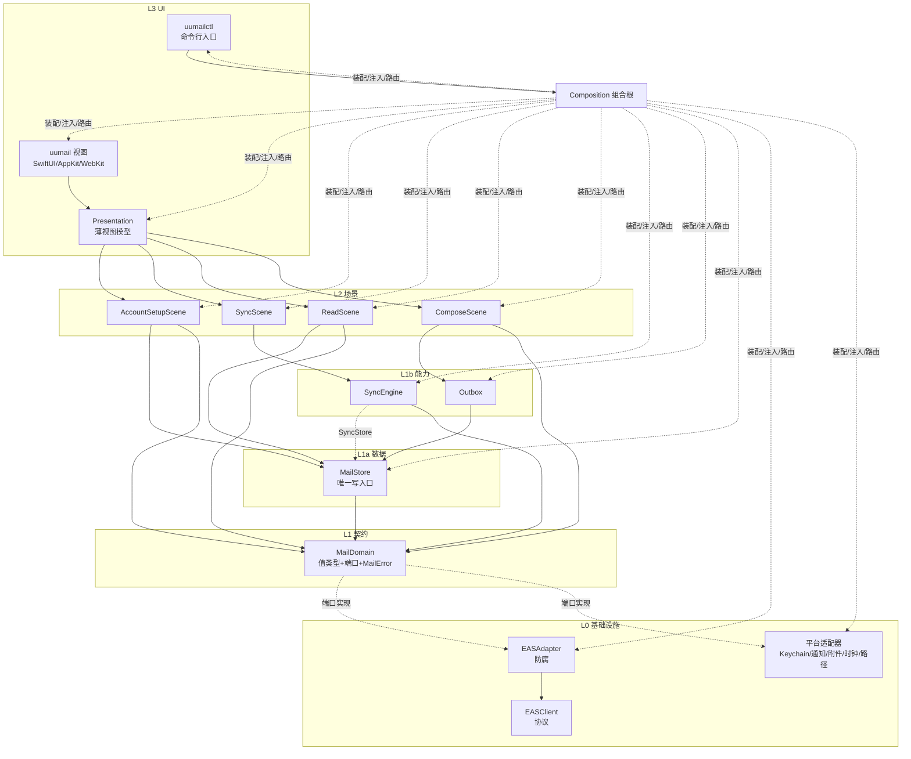

# uumail 架构规格

macOS 原生邮件客户端，只支持 EAS（Exchange ActiveSync），以「一台已登记的 iPhone」身份接入私有化 Exchange 2016/2019。首版覆盖账号接入、文件夹与收件箱同步、阅读、发送、附件、本地搜索、离线缓存与系统通知。

本文是**现行架构真相**。2026-11-10 起的场景收口与分层重构（W-SCN-REFACTOR）已冻结并落地：9 个库 target + 2 个可执行 target，`AppServices` 退役，4 个场景类收口每条业务流。过程记忆与裁决见 `history/works/2026-11-10-scene-refactor/`，不作为设计依据。

## 0. 结论先行

- **技术基线**：Swift 6 + SwiftUI（AppKit 补 WebView），SQLite（GRDB 7.12）本地库，自研 EAS 协议层（WBXML + 命令集），Basic Auth over TLS。
- **分层**：L3 视图 + `Presentation` 薄视图模型 → L2 四个场景 → L1b `SyncEngine`/`Outbox` → L1 `MailDomain`（值类型 + 端口 + `MailError`）→ L1a `MailStore`（唯一写入口）→ L0 `EASClient` + `EASAdapter`（防腐）与平台适配器。
- **一条主线**：UI 只读本地库；网络同步全部在后台冷路径；打开邮件、列表滚动、发送入队都不等待网络。
- **一个不变量**：Sync 批次与新的 SyncKey 必须**同一事务**落库，先写数据后提交 key。
- **发送**：`ComposeScene.send` 只入队，`Outbox` 冷投递；`ClientId = outboxID` 作幂等键，120s 租约防跨进程双投。
- **组合根**：`Composition` 只装配、注入、路由与生命周期；业务判断一律留在场景（D9）。
- **结构决策**：D1–D10 见 §8.1，均已落地；2026-11-09 的技术选择见 §8.2。

## 1. 业务能力与约束

| 能力 | owner 场景/组件 | 触发 | 结果 | 规则/不变量 | 数据 | 失败语义 | 频率 | 冷/热 | 实现状态 |
|---|---|---|---|---|---|---|---|---|---|
| 账号接入 | `AccountSetupScene` | 用户填表点连接 | 账号 `ready` + 文件夹树 + 凭据入 Keychain | 顺序固定（probe→provision→文件夹→建号→快照→ready→凭据）；失败不留半成品 | accounts、folders、sync_state、Keychain | 分类错误，停在配置页 | 首次/换机 | 冷 | 已实现；真机全链未跑 |
| 文件夹与收件箱同步 | `SyncScene` | 启动、每 5 分钟、手动刷新 | 本地出现新文件夹与新邮件 | 单飞；批次与 key 同事务；失败保旧数据 | folders、messages、sync_state | 状态栏错误，后台退避 | 每 5 分钟 | 冷 | 已实现 |
| 浏览与阅读 | `ReadScene` | 选文件夹、选邮件 | 列表与正文 | 读路径不触网；缓存优先；缺正文先占位后补拉 | messages、message_bodies | 占位 + 重试入口 | 高频 | 热 | 已实现；P95 未复测 |
| 附件 | `ReadScene` | 点附件 | 本地文件并打开 | 同一附件单飞；缓存 2 GB 最旧优先 | attachments、附件文件 | 提示失败可重试 | 中 | 冷 | 部分：无 25MB 上限、续传、名称回退 |
| 本地搜索 | `ReadScene` | 输入关键字 | 结果列表 | 本地优先；<3 字符走 LIKE | messages、fts | 空结果/错误提示 | 中 | 热 | 已实现 |
| 撰写/回复/转发 | `ComposeScene` | 新建/回复/转发 | 草稿或入队 | 引用规则；发送只入队 | outbox | 入队失败提示 | 中 | 热（入队） | 已实现 |
| 投递 | `Outbox` | 入队、启动、重试、定时泵 | 送达或失败态 | 最多成功一次；租约防并发；永久失败保留内容 | outbox | 退避/标红 | 冷 | 冷 | 已实现；UI 无角标 |
| 新邮件通知 | `SyncScene` | 同步新增 > 0 | 系统通知 | 通知失败不影响同步 | 无 | 静默降级 | 每 5 分钟 | 冷 | 已实现 |

### 1.1 环境与协议约束（实测，细节见 `design/components/CMP-EAS/playbook.md`）

- 外网只发布 `/Microsoft-Server-ActiveSync`；`/EWS`、`/autodiscover` 均 404，账号配置以手填服务器为主路径。
- 网关按 `DeviceId` 登记设备；未登记设备读命令回 `200` 空 body、写命令回 `401`。`deviceId` 由用户从已激活旧设备填入，不写进代码库。
- `OPTIONS` 必须裸 URL；线格式以实测字节为准（NUL 结尾字符串、opaque MIME），规范字面会让网关挂 20s 后 `502`。
- `Ping` 三档心跳均 `Status=4`，**不支持长轮询**；固定 5 分钟轮询，UI 如实标注刷新节奏。
- GAL / `Search` / `Find` 不可用；联系人只做本机通讯录 + 收件人历史。

### 1.2 三条变化轴

1. **EAS 网关行为**（状态码、线格式、设备策略）→ 只改 `EASAdapter` / `EASClient`，场景与领域契约不动。
2. **发送通道**（EAS SendMail → 其他）→ 只换 `MailGateway.send` 实现，`Outbox` 状态机不动。
3. **窗口与交互形态**（单窗口 → 多窗口/菜单栏）→ 只改 `Presentation` 与视图。

### 1.3 三条不变量

1. UI 读路径不触网：列表、正文命中、搜索都只读本地库。
2. 同一账号同一集合同时只有一个 Sync 在飞；SyncKey 与批次同事务提交。
3. 发送意图不丢、不双发：入队即成功，投递最多成功一次。

### 1.4 三个最痛失败

1. SyncKey 失步 → 重信/丢信（对策：原子提交 + 幂等 upsert + status 3/4 重建）。
2. 发送被吞或双发（对策：`Outbox` 状态机 + 120s 租约 + `ClientId` 幂等键）。
3. 设备未登记被误判为网络问题（对策：单一 `MailError` 目录 + 场景层不重试规则）。

## 2. 分层、target 与组件地图



依赖方向：L2 → L1 契约；L1 → 自定端口；L0 实现端口，由组合根注入。L0 不调用 L1/L2 业务代码，L1 不调用 L2。

### 2.1 Target 清单（`Package.swift`）

| Target | 层 | 依赖 | 入口 |
|---|---|---|---|
| `MailDomain` | L1 | Foundation | `Sources/MailDomain/{Values,Ports,Errors,Configuration}.swift` |
| `MailStore` | L1a | `MailDomain`、GRDB | `Sources/MailStore/MailStore.swift#MailStore` |
| `SyncEngine` | L1b | `MailDomain` | `Sources/SyncEngine/SyncEngine.swift#SyncEngine` |
| `Outbox` | L1b | `MailDomain`、`MailStore` | `Sources/Outbox/Outbox.swift#Outbox`、`MimeBuilder.swift#MimeBuilder` |
| `EASClient` | L0 | Foundation | `Sources/EASClient/EASClient.swift#EASClient`、`WBXML.swift#WBXML` |
| `EASAdapter` | L0（防腐） | `MailDomain`、`EASClient` | `Sources/EASAdapter/EASAdapter.swift#EASAdapter` |
| `Scenes` | L2 | `MailDomain`、`MailStore`、`SyncEngine`、`Outbox` | `Sources/Scenes/*Scene.swift` |
| `Presentation` | L3 | `MailDomain`、`Scenes`、Observation | `Sources/Presentation/*ViewModel.swift` |
| `Composition` | 根 | 全部库 target | `Sources/Composition/AppComposition.swift#AppComposition`、`CommandLineComposition.swift#CommandLineComposition` |
| `uumail`（可执行） | L3 | `Composition`、`Presentation` | `Sources/uumail/UumailApp.swift#UumailApp` |
| `uumailctl`（可执行） | L3 | `Composition`、`Scenes`、`MailDomain`、`EASClient` | `Sources/uumailctl/UumailCtl.swift#UumailCtl` |

### 2.2 责任收口表（一句话测试）

| 业务流 | 唯一顶层组合 | 它拥有规则 | 不在别处 |
|---|---|---|---|
| 接入 | `AccountSetupScene.connect/validate` | 验证顺序、失败回滚、错误分类 | 视图不再拼装账号 |
| 收取 | `SyncScene.refresh/startAutoRefresh` | 刷新节奏、单飞、通知条件、失败态 | App 的 `.task` 不再轮询 |
| 阅读 | `ReadScene.open/downloadAttachment` | 缓存优先、补拉落库、附件单飞与预算 | 视图不再决定「先读库还是先拉网」 |
| 撰写发送 | `ComposeScene.send/saveDraft` | 回复引用、入队语义、草稿状态 | 视图模型不再调发送服务 |
| 投递 | `Outbox.flushOnce/flushAll/retry/cancel` | 状态机、退避、租约、幂等 | 场景不直接发 SMTP/EAS |

### 2.3 组件索引

| 组件 | 规格 | 层 |
|---|---|---|
| `CMP-DOMAIN` | `design/components/CMP-DOMAIN/spec.md` | L1 契约 |
| `CMP-STORE` | `design/components/CMP-STORE/spec.md` | L1a 数据服务 |
| `CMP-SYNC` | `design/components/CMP-SYNC/spec.md` | L1b 能力 |
| `CMP-OUT` | `design/components/CMP-OUT/spec.md` | L1b 能力 |
| `CMP-EAS` | `design/components/CMP-EAS/spec.md` + `playbook.md` | L0 协议 |
| `CMP-EASADAPTER` | `design/components/CMP-EASADAPTER/spec.md` | L0 防腐 |
| `CMP-SCN-ACCOUNT` | `design/components/CMP-SCN-ACCOUNT/spec.md` | L2 场景 |
| `CMP-SCN-SYNC` | `design/components/CMP-SCN-SYNC/spec.md` | L2 场景 |
| `CMP-SCN-READ` | `design/components/CMP-SCN-READ/spec.md` | L2 场景 |
| `CMP-SCN-COMPOSE` | `design/components/CMP-SCN-COMPOSE/spec.md` | L2 场景 |
| `CMP-PRES` | `design/components/CMP-PRES/spec.md` | L3 表现 |
| `CMP-APP` | `design/components/CMP-APP/spec.md` | L3 视图 |
| `CMP-ROOT` | `design/components/CMP-ROOT/spec.md` | 根（装配 + 路由） |
| `CMP-CLI` | `design/components/CMP-CLI/spec.md` | L3 交付入口 |

### 2.4 禁止边

| 禁止 | 守门方式 |
|---|---|
| `Scenes`/`Presentation` → `EASClient`/`EASAdapter` | import 白名单（`Scripts/check-architecture.sh` 门 1） |
| `Presentation`/视图 → `MailStore`/`SyncEngine`/`Outbox` | import 白名单 |
| 视图 → `Scenes`；除 `UumailApp.swift` 外视图 → `Composition` | import 白名单 + 文件级限制 |
| `MailStore` → `MailGateway`/`EASClient` | import 白名单 |
| L1 → L2、同层横向互调（场景之间直接调用） | import 图 + 文件名扫描 + 评审 |
| 任何模块内用环境变量挑选实现 | 组合根唯一；review |
| `Composition` 调业务方法/判业务状态 | 架构脚本：禁 `MailError`/`SyncState`/`OutboundState` 的 switch；`AppComposition` ≤200 行 |

**例外（显式登记）**：`uumailctl` 的 `options/provision/ping/diagnose` 与不带 `--db` 的 `body` 允许直连 `EASClient`，因为它们是协议探针而非业务流；`sync/send/folders/seed/body --db` 必须走场景（D8）。

### 2.5 扇出与扇入

| 模块 | 扇出 | 预算 | 说明 |
|---|---|---|---|
| `MailDomain` | 0 | ≤5 | 纯契约 |
| `MailStore` | 2 | ≤4 | `MailDomain` + GRDB |
| `SyncEngine` | 1 | ≤5 | 只依赖 `MailDomain`（`SyncStore` 端口） |
| `Outbox` | 2 | ≤4 | `MailStore` + `MailGateway`（MIME 内部） |
| `EASAdapter` | 2 | ≤5 | `MailDomain` + `EASClient` |
| 每个场景 | 1–2 | ≤5 | 端口计入 `MailDomain`，不重复计 |
| `Presentation` | 1 | ≤3 | 只依赖 `Scenes`（与 `MailDomain` 值类型） |
| `Composition` | 8 | 豁免 | 组合根（全部库 target） |

扇入：`MailDomain` 被全部模块依赖（平台级 → 契约评审、兼容性测试）；`MailStore` 被 `Outbox`/`Scenes`/`Composition` 依赖（扇入 3；作为唯一数据写入口，写契约变更按 P1）；`Scenes` 被 `Presentation` 与 `uumailctl` 依赖。

## 3. 核心契约

契约卡全文在各组件规格；本节只给现行摘要与入口，避免两处维护。

### 3.1 `MailGateway` v2（L1 端口）

```swift
public protocol MailGateway: Sendable {
    func probe() async throws -> ServerCapabilities
    func provisionIfNeeded() async throws
    func fetchFolders(syncKey: String) async throws -> FolderListing
    func fetchMessages(collectionID: String, syncKey: String, window: Int, filterType: Int) async throws -> MessageDelta
    func fetchBody(collectionID: String, serverID: String) async throws -> FetchedBody
    func fetchAttachment(fileReference: String) async throws -> Data
    func send(mime: Data, clientID: String) async throws
}
```

- `FetchedBody{text, isHTML, isTruncated}` 保留正文类型与截断标记（D10，`history/decisions/2026-11-13-fetched-body-contract.md`）；场景层负责纯文本转 HTML，展示层保留截断提示。
- 不泄漏 EAS 类型/状态码；`send` 成功当且仅当服务器返回 `200` 且 0 字节 body。
- 错误只有一个目录 `MailError`（9 个 case）；映射只发生在 `EASAdapter.map`。
- 唯一生产实现：`EASAdapter`（`Sources/EASAdapter/EASAdapter.swift`）。

### 3.2 `SyncStore`（L1 端口，`MailStore` 直接遵循）

```swift
public protocol SyncStore: Sendable {
    func folders(_ account: AccountID) throws -> [Folder]
    func applyFolderSnapshot(_ account: AccountID, folders: [Folder], syncKey: String) throws
    func syncKey(_ account: AccountID, collection: String) throws -> String?
    func applySyncBatch(_ account: AccountID, folder: String, delta: MessageDelta) throws
    func resetCollection(_ account: AccountID, folder: String) throws
}
```

- 同步调用（本地库）；`MailStore` 在 `SyncStoreConformance.swift` 直接遵循，`StoreAdapter` 已删除（D6）。
- 不变量：批次与 key 同事务；失败不推进 key；`(account, folder, serverID)` 幂等。

### 3.3 平台端口（`MailDomain`）

`CredentialStore`（Keychain/内存）、`Notifier`（系统通知/静默）、`AttachmentFiles`（附件缓存）、`MailClock`（可注入时钟）。

- 实现都在 `Composition/Platform/`：`KeychainCredentialStore`、`EphemeralCredentialStore`、`SystemNotifier`、`FileAttachmentFiles`、`SystemMailClock`、`AppPaths`；CLI 另有 `SilentNotifier`（`CommandLineComposition` 内）。
- `AttachmentFiles.store` 原子写并执行预算淘汰（2 GB 最旧优先，`history/decisions/2026-11-09-attachment-cache-cap.md`）。

### 3.4 `MailStore` v2（schema v8 → v9 delta）

| 契约 | 说明 |
|---|---|
| `createAccount/markAccountReady/discardAccount/account` | 账号行状态：`draft → ready`；回滚只删无消息的账号 |
| `claimOutbox(account:now:lease:)` | `UPDATE … RETURNING` 单句领取 `queued`、到期 `failed_retryable`、租约过期 `sending`；并发进程不双领 |
| `markOutboxSent/markOutboxFailed/releaseOutbox/cancelOutbox/outboxItem` | 行级状态机写契约 |
| `applyFolderSnapshot/applySyncBatch/applyBody/body` | 文件夹快照、批次与 key 同事务、正文分表 |
| `messages/searchLocal/attachments/markAttachmentCached` | 读与附件缓存标记 |
| `saveDraft/enqueueOutbox/pendingOutbox` | 草稿不入队、发送意图入队 |

- schema v8（`v8_outbox_v2`）：`outbox` 增加 `sending_since`、`next_attempt_at`；状态取值 `draft/queued/sending/failed_retryable/failed_permanent/canceled`（旧 `failed` → `failed_retryable`）。
- schema v9（`v9_message_cc`，T-1114-05）：`messages` 加可空 `cc` 列，并把非 `folders` 的 message `sync_key` 置 `"0"` 触发一次回填；保留正文/附件，不调用 `resetCollection`。`applySyncBatch` 写入 To/Cc 且用 `COALESCE` 防止只带 `Read` 的 `Change` 清空已有值；`messages`/`searchLocal` 都映射 `recipients` 与 `cc`。
- 错误：`MailStoreError` 含 `folderNotFound/accountNotFound/invalidFolder/outboxNotClaimable/accountNotEmpty/database`。
- 迁移测试：`Tests/MailStoreTests/MigrationTests.swift` 用 pre-v8 fixture 验证 `failed` 前滚与旧字段可读，用 pre-v9 fixture 验证 `cc` 空可读、正文/附件保留、消息游标归零与回填写入。

### 3.5 `Outbox`（L1b actor）

```swift
public actor Outbox {
    public func enqueue(_ draft: Draft, account: AccountID) throws -> OutboxID
    public func flushOnce(account: AccountID) async -> DeliveryOutcome?
    public func flushAll(account: AccountID) async -> [DeliveryOutcome]
    public func retry(_ id: OutboxID, account: AccountID) throws
    public func cancel(_ id: OutboxID, account: AccountID) throws
    public func state(of id: OutboxID, account: AccountID) throws -> OutboundState?
    public func pending(account: AccountID) throws -> [OutboxItem]
}
```

- 入队只写本地行并立即返回；投递在 `flush*`；`ClientId = outboxID`；成功即删行。
- 租约 120s，`send` 超时 90s；退避 30s→2m→10m→30m 后翻倍封顶 24h；`offline`/`throttled` 可重试，`authFailed`/`deviceNotRegistered`/`policyBlocked`/`unsupported` 永久失败，手动 `retry` 才再投。
- 取消：`queued/failed_*` 直接落 `canceled`；`sending` 中只记进程内标记，投递返回后落终态。

### 3.6 场景（L2）

| 场景 | 入口 | 规格 |
|---|---|---|
| `AccountSetupScene` | `validate`、`connect` | `design/components/CMP-SCN-ACCOUNT/spec.md` |
| `SyncScene`（actor） | `refresh`、`startAutoRefresh`、`stopAutoRefresh` | `design/components/CMP-SCN-SYNC/spec.md` |
| `ReadScene` | `folders/messages/search/attachments/bodyIfCached/open/downloadAttachment` | `design/components/CMP-SCN-READ/spec.md` |
| `ComposeScene` | `replySeed/replyAllSeed/forwardSeed/saveDraft/send/pending/retry/cancel` | `design/components/CMP-SCN-COMPOSE/spec.md` |

场景是值类型或 actor，不持有 `@Observable` UI 状态；场景之间不互相调用（门 2）。

### 3.7 `Presentation`

`MailboxViewModel`、`ComposeViewModel`、`AccountSetupViewModel`；`BodyPresentation{none/loading/loaded(html,truncated)/failed(text)}`、`BodyNotice`、`SyncPresentation`、`Selection`；`ErrorText` 是唯一的 `MailError → 中文` 映射，`DisplayFormat` 收拢发件人与日期格式化。只依赖 `Scenes` + `MailDomain`。

## 4. 冷热路径

| 路径 | 类型 | 同步依赖 | 失败与降级 | 资源隔离 | 现行证据 |
|---|---|---|---|---|---|
| 列表/阅读（命中缓存） | 热 | 0 | 本地错误直接呈现；正文缺失先占位 | 读连接 + WAL | `ScenesTests` 缓存命中零网络；`PresentationTests` 状态序列 |
| 发送入队 | 热 | 0 | 入队失败保留编辑内容 | 本地事务 | `ComposeSceneTests` 入队不触网 |
| 阅读补拉 | 冷 | 1（gateway） | `failed(MailError)`，保留占位/摘要；取消不落库 | 同一 `MessageRef` 单飞 | `ReadSceneTests` 先落库再 yield、失败不覆盖缓存 |
| 同步刷新 | 冷 | 1（gateway） | 保留旧数据；auth/device/policy 暂停自动刷新 | 单账号 actor | `SyncSceneTests` 单飞/通知/暂停 |
| 投递 | 冷 | 1（gateway） | 可重试退避；永久失败保留内容 | 独立 actor + 泵，不共享同步队列 | `OutboxTests` 租约/退避/幂等；`OutboxPumpTests` |
| 附件下载 | 冷 | 1（gateway） | 抛 `MailError`，可重试 | 同一附件单飞；缓存 2 GB | `ReadSceneTests`、`FileAttachmentFilesTests` |
| FTS 索引 | 冷 | 0 | 重建可重入 | 随事务增量 | `MailStoreTests` 搜索用例 |

**观测**：`last_sync_at`、`sync_key_age`、`outbox_pending`、`outbox_failed`、`sync_duration`、`batch_size`、`throttle_count`。当前 UI 只展示 `lastSyncedAt` 与失败文案；outbox 计数尚未进 UI（见 §10 残留）。

## 5. 数据所有权与 schema

| 实体 | 唯一写入口 | 写契约 | 读方 | 一致性 |
|---|---|---|---|---|
| accounts | `MailStore` | `createAccount/markAccountReady/discardAccount` | `AccountSetupScene`、`Composition` | 强 |
| folders | `MailStore` | `applyFolderSnapshot` | `ReadScene`、`SyncEngine` | 强 |
| messages | `MailStore` | `applySyncBatch` | `ReadScene`、`SyncScene` | 强 |
| message_bodies | `MailStore` | `applyBody`（经 `ReadScene`） | `ReadScene` | 强 |
| attachments | `MailStore` | `markAttachmentCached` + `applySyncBatch` | `ReadScene` | 强 |
| sync_state | `MailStore` | `applySyncBatch/applyFolderSnapshot/resetCollection` | `SyncEngine` | 强（与批次同事务） |
| outbox | `MailStore`（物理行）/ `Outbox`（状态机） | `enqueueOutbox/claimOutbox/markOutbox*` | `ComposeScene`、`Outbox` | 强（本地） |
| fts | `MailStore` | 随 `applyBody/applySyncBatch` 增量 | `ReadScene.search` | 最终（同事务） |
| Keychain 凭据 | `CredentialStore` 实现 | `save/delete` | `Composition`、`AccountSetupScene` | 强 |
| 附件文件 | `AttachmentFiles` 实现 | `store` | `ReadScene` | 强（文件系统） |

**未建**：`pending_op`（已读/移动/删除的本地意图）。本次只登记扩展点，不建表（见 §10）。

本地库为明文 SQLite（WAL + FTS5），附件缓存同样明文；加密依赖 FileVault，不做 SQLCipher、无审计日志——2026-11-09 安全审计的已知接受项（`plan/risks.md` R12）。

## 6. 装配、复用与组合根（D9）

### 6.1 对象图

```
AppComposition（180 行）
├─ ConfigurationSource：Keychain / DEBUG 环境（DB 路径由它解析，CLI 的 --db 在命令层覆盖）
├─ MailStore(path:)
├─ GatewayFactory → PlatformGateway.make(ServerConfiguration) → EASAdapter(EASClient)
├─ scenes: AccountSetupScene / SyncScene / ReadScene / ComposeScene
├─ viewModels: AccountSetupViewModel / MailboxViewModel
├─ Outbox + OutboxPump（启动补投、30s 周期、入队信号、可停可重启）
└─ 生命周期：start/stop（autoRefresh、pump、bootstrapTask）

CommandLineComposition（127 行）
├─ 环境配置（EAS_HOST/EAS_USER/EAS_PASS/EAS_DOMAIN/EAS_DEVICE_ID）
├─ MailStore(path: --db)
├─ 无账号行 → AccountSetupScene.connect 引导（内存凭据，不写 Keychain）
└─ read / sync / compose / outbox + SilentNotifier
```

### 6.2 只装配、只路由

组合根只允许三件事：**构造**（读配置、`new` 对象）、**注入**（端口与场景依赖按构造参数传入）、**路由与生命周期**（有账号行 → 邮箱；无账号行但有配置 → 一次 setup 引导；启动/停止自动刷新与投递泵）。

| 允许 | 禁止 |
|---|---|
| 读 Keychain / 环境配置 | 读/写邮件、文件夹、outbox 等业务数据 |
| 构造对象、传参、持有引用 | 调 `MailGateway`/`SyncEngine`/`Outbox`/`MailStore` 的业务方法 |
| `if 有账号行 { 邮箱 } else { 配置页 }` 这类**状态路由** | `switch MailError`、`if report.added > 0`、按 outbox/同步状态分支 |
| `start/stop` 长生命周期任务 | 重试、退避、`sleep`、队列消费逻辑 |
| 选择 App/CLI 形态、DEBUG 配置来源 | 业务错误文案、日期/发件人格式化、MIME 组装 |
| 记录装配失败并显示配置页 | 用环境变量挑业务实现（唯一例外：`UUMAIL_DEBUG_ENV` 只改**配置来源**） |

**腐化信号**（出现任一条即停下重切）：组合根出现 `MailStore` 的业务查询/写入；出现业务类型上的 `switch/case`；出现 `for/while + try await` 的流程；`AppComposition` 超过 200 行；平台适配器里出现业务判断。

**测试面**：`CompositionTests` 只做装配冒烟（对象图、路由、bootstrap、泵启停、DEBUG 凭据不落 Keychain），业务正确性在场景/组件测试里证。

### 6.3 复用归位（已落地）

| 重复项 | 处置 |
|---|---|
| 三套消息结构（EAS/Store/Domain） | 保留三层，转换只在 `EASAdapter` 与 `MailStore` |
| 账号「取首个或新建」 | 上提 `AccountSetupScene`，CLI 副本删除 |
| 错误 → 中文文案 | 只留 `Presentation/ErrorText` 一张表 |
| 时间/发件人格式化 | 收进 `Presentation/DisplayFormat` |
| 附件缓存路径与淘汰 | 收进 `FileAttachmentFiles` |
| MIME 组装 | 收进 `Outbox/MimeBuilder` |

## 7. 验证与 CI

### 7.1 当前验证面

- `./Scripts/swiftw test` → **181 tests / 38 suites**（2026-11-14，T-1114-07 后复测）。
- 测试 target：`MailDomainTests`、`MailStoreTests`、`SyncEngineTests`、`OutboxTests`、`EASClientTests`、`EASAdapterTests`、`ScenesTests`、`PresentationTests`、`CompositionTests`。
- `bash Scripts/check-architecture.sh` → 4 门：per-target import 白名单、场景互调、`AppComposition` ≤200 行、`Composition` 业务 switch。4 门全过。
- schema 迁移：`MailStoreTests/MigrationTests` 的 pre-v8 与 pre-v9 fixture。
- 性能：`MailStoreTests/PerformanceTests` 5k 基线；重构后未复测 P95。

### 7.2 门禁的已知局限

- 场景互调门按「一文件一场景类」文件名判定（`Sources/Scenes/*Scene.swift`）；新场景拆文件会漏判。
- 组合根 switch 门用业务 case 标签 + `switch` 主语匹配，通用标签（`case .idle`）依赖主语命名。
- 迁移 fixture 只重建 `accounts`/`outbox` 两表，其余表登记为已应用。

### 7.3 发布前仍需

真机冒烟：`uumailctl diagnose/sync/send`；App 启动一次真实 bootstrap（有 Keychain 凭据、空账号行）；离线发送 → 联网只发一封。以上本会话**未验证**。

## 8. 决策记录

### 8.1 W-SCN-REFACTOR 结构决策（D1–D10，均已落地）

| ID | 决策 | 理由 / 被否决项 |
|---|---|---|
| D1 | 4 个场景类；搜索并入阅读、通知并入同步 | 每 SCN 一类：搜索/通知退化为透传；每窗口一类：重现上帝类 |
| D2 | `send` 只入队，`Outbox` 冷投递；UI 显示「已加入发件箱」 | 同步发送：断网卡死、离线可用无法兑现 |
| D3 | `SyncEngine` 降为 L1b 能力，场景可直接依赖 | 留在 L2：场景调它构成横向调用，只能造假端口绕开 |
| D4 | 9 个库 target + 2 个可执行 target；`AppServices` 退役 | 单 target：分层无法由编译器守住；更细拆分：`MimeBuilder` 等不足独立边界 |
| D5 | 场景值类型 / actor + 薄视图模型 | 场景即 `@Observable` VM：编排与展示同因变化，CLI 无法复用 |
| D6 | `SyncStore` 去 `async`、`MailStore` 直接遵循、删 `StoreAdapter` | 保留适配器：只做机械转换，属透传 |
| D7 | outbox 状态显式取值 + 租约列（schema v8） | 复用 `failed` + 计数：跨进程与重试分类无法准确表达 |
| D8 | CLI 诊断命令允许直连 `EASClient` | 把 `ping/options` 塞进 `MailGateway`：为诊断扩大业务契约 |
| D9 | 组合根只装配、注入、路由；业务判断一律不进组合根 | 在组合根读业务状态/做失败分支：会逐步长成第二个 `MailService` |
| D10 | `fetchBody` 返回 `FetchedBody{text,isHTML,isTruncated}`，不压成 `String` | 保留截断提示与纯文本渲染规则；压成 `String` 会丢 `Type`/`Truncated`，要改场景不变量 |

D10 的决策记录：`history/decisions/2026-11-13-fetched-body-contract.md`。D1–D10 的评审与裁决过程：`history/works/2026-11-10-scene-refactor/review.md` 与同目录 `result.md`（过程记忆，不作设计依据）。

### 8.2 2026-11-09 技术选择（T1–T13）

> 2026-11-09 经人确认（记录见 `history/decisions/2026-11-09-scope-baseline.md`）。为与本次结构决策 D1–D10 区分，本表改用 T 编号；冻结记录仍用当时的 D 编号。

| ID | 选择 | 理由 | 否决 |
|---|---|---|---|
| T1 | 自研 WBXML 与 EAS 命令层 | Swift 生态无成熟 EAS 客户端库；协议面可控 | 引第三方库：维护停滞、无法定制设备身份 |
| T2 | GRDB + SQLite（WAL + FTS5） | 迁移、事务、FTS、只读连接齐备 | Core Data：FTS 弱；裸 SQLite：迁移与并发自己扛 |
| T3 | 首版 5 分钟轮询；Ping 不支持长轮询 | 无服务端推送依赖；三档心跳均 `Status=4` | 常驻 IMAP 式连接：与 EAS 无关 |
| T4 | 设备身份可配置、协议版本可降级 | 兼容不同服务器与手机识别 | 固定 UA 写死：遇策略差异即死 |
| T5 | WKWebView + 默认阻止远程资源；单封可临时放行 | HTML 邮件是最大攻击面 | 全局阻止：图片类邮件显示不全；默认加载：追踪风险 |
| T6 | 发送先入本地 Outbox | 断网可写、失败可重试 | 同步发送：网络抖动直接丢信 |
| T7 | 富文本用 AttributedString → multipart/alternative + 附件 multipart/mixed | 原生编辑体验、MIME 可测 | 只支持纯文本：不满足撰写需求 |
| T8 | 单账号优先，schema 预留 account_id | 首版收敛；多账号是数据隔离而非结构重写 | 首版多账号：复杂度翻倍 |
| T9 | Provision 只做最小握手：维护 PolicyKey，不解析策略项 | 首版不接入强制策略服务器 | 完整策略展示 + 用户同意：为当前环境付复杂度 |
| T10 | DeviceId 手填（高级设置） | 网关按 DeviceId 登记；不把设备 ID 带进代码库 | 写死受控值：换机需发版且泄密风险 |
| T11 | 发送失败件保留 24h / 100 条 | 弱网可补发，队列不无限堆积 | 永久保留：易误以为已发出 |
| T12 | 联系人只做本机通讯录 + 收件人历史 | GAL 实测不可用 | 继续排查 GAL：无保证且推迟 M3 |
| T13 | 不做 OAuth/Graph 抽象 | 目标是私有化 Exchange 的 EAS 客户端 | 预留 OAuth 端口：为不存在的需求付费 |

## 9. 实施阶段

| 阶段 | 内容 | 状态 |
|---|---|---|
| M0 协议探针 | `OPTIONS → Provision → FolderSync → Sync → ItemOperations → SendMail`，产出样本与服务器行为记录 | 已完成（`history/works/2026-11-09-eas-probe/`） |
| M1 只读客户端 | 账号配置、文件夹树、列表、正文、附件、离线缓存 | 进行中：账号、文件夹树、列表、正文已实现；附件场景 02–04 未实现；场景卡待 `verified` |
| M2 发送与草稿 | Outbox、SendMail、回复/转发、草稿、Sent 镜像 | 进行中：Outbox/投递/草稿/回复转发已实现；Sent 镜像与撰写附件未做；场景卡待 `verified` |
| M3 体验 | Ping、通知、本地搜索、错误恢复与空态 | 进行中：Ping 不支持 → 5 分钟轮询；通知与搜索已实现；场景卡待 `verified` |
| M4 加固 | 策略、限流、安全、性能 | 已完成（`history/works/2026-11-09-m4-hardening/`） |
| W-SCN-REFACTOR 结构收口 | 4 场景、9 库 target、组合根、Outbox、schema v8 | 已完成（2026-11-14）：159 测试 / 37 suites，4 项架构门全过；归档 `history/works/2026-11-10-scene-refactor/` |

## 10. 开放问题、残留与定级

### 10.1 仍在悬空的问题

单一来源是 `plan/open-questions.md`：

- Q1 本地保留策略（正文裁剪）：M1 用真实邮箱规模定，未定。
- Q2 `PendingOps`（已读/移动/删除）的落地时机与表结构：本次只留扩展点。
- Q3 App 与 CLI 同库双跑的进程级账号租约：目前只有 outbox 行级租约，同步游标互顶仍可能（M4 候选）。
- Q4 单账号替换（改服务器/账号）的旧数据处理：未定义。

### 10.2 本次收口登记的残留

1. **真机冒烟未跑**：`uumailctl diagnose/sync/send` 与 App 的 live bootstrap 未在本会话验证；CLI 侧只有装配测试。
2. **UI 无待发/失败 outbox 角标**：发送只入队后，列表/状态栏看不到 pending/failed 数（`plan/risks.md` R13）。
3. **`MailStore`/`SyncEngine` 的过渡 `typealias` 未删**（`MailStore/Values.swift`、`SyncEngine/Values.swift`），仍指向 `MailDomain`。
4. **PolicyKey 不持久化**：只存在 `EASClient` 实例内，每个新进程首命令前重新 Provision；旧场景卡「PolicyKey 入 Keychain」已按代码更正。
5. **`SyncEngine.start/stop/stateStream` 未实现**：维持 `syncOnce/currentState`，节奏归 `SyncScene`。
6. **附件场景未完整**：25MB 上限、断点续传、`AttachmentName` 回退、真机下载/打开未做。
7. **阅读场景**：已读回写服务器、sanitizer 自动化断言、1 万封 P95 未做。
8. **失败件保留上限（24h / 100 条，T11）无清理实现**：outbox 行会保留到成功、取消或手动重试。
9. **`backup/pre-autosquash` 分支保留**，不删。

### 10.3 定级与冻结

**P1**：模块切分/合并（6 个新 target、`AppServices` 退役）、核心契约（`MailGateway` v2、`SyncStore` 变更）、核心 schema（outbox v8）、分层依赖（EAS 退到 L0）、热路径发送语义。

- 规格冻结：2026-11-13，整体结论通过，D1–D9 逐条确认；D10 于 2026-11-13 追加。
- 结构收口：2026-11-14，T-1110-10 把规格并入本文与组件规格，工序目录归档。
- 后续契约变更走新决策记录（`history/decisions/`），并同步改对应组件规格与 pinning test。
