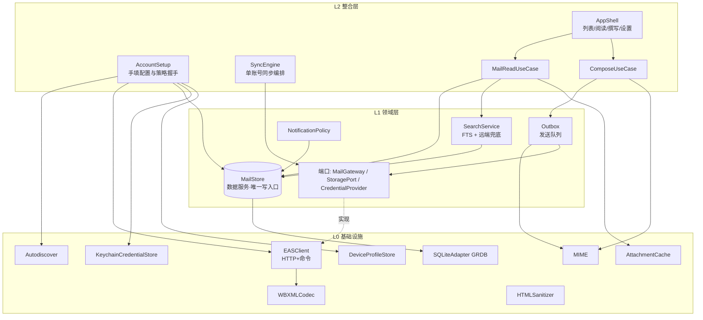

# uumail 架构规格草案（P1）

macOS 原生邮件客户端，只支持 EAS（Exchange ActiveSync），以手机设备身份接入；首版覆盖账号配置、文件夹同步、阅读、发送、附件、本地搜索、离线缓存与系统通知。本文是 P1 架构规格，关键决策已确认（`history/decisions/2026-11-09-scope-baseline.md`），2026-11-09 授权开始编码。服务器接入部分已用真实环境验证，见 §7 与 `design/components/CMP-EAS/playbook.md`。

## 0. 结论先行

- **技术基线**：Swift 6 + SwiftUI（AppKit 补 WebView/富文本短板），SQLite（GRDB）本地库，自研 EAS 协议层（WBXML + 命令集），Basic Auth over TLS，目标本地 Exchange 2016/2019。
- **协议基线已验证**：2026-11-08 用命令行探针在公司外网打通 EAS 16.1（`OPTIONS → Provision → FolderSync → Sync → ItemOperations → SendMail`）。线格式（NUL 结尾字符串、opaque MIME、最小 Sync 体）与设备登记规则以实测为准，不以规范字面为准；证据见 `history/works/2026-11-09-eas-probe/`，操作细节见 `design/components/CMP-EAS/playbook.md`。
- **一条主线**：UI 只读写本地库，网络同步全部在后台冷路径。打开邮件、列表滚动、发送入队都不等待网络。
- **一个不变量**：Sync 批次与新的 SyncKey 必须**同一事务**落库，先写数据后提交 key；否则丢信或重复。
- **已确认的结构决策（2026-11-09）**：Provision 最小握手；单账号；DeviceId 手填（高级设置）；失败件 24h/100；联系人只做本机通讯录 + 历史；不做 OAuth/Graph。记录见 `history/decisions/2026-11-09-scope-baseline.md`；仍未决的只有本地保留策略与附件缓存上限（`plan/open-questions.md`）。
- **定级 P1**：新系统、模块切分、核心 schema、热路径架构，需用户参与边界与契约评审后冻结。

## 1. 业务能力与约束

| 能力 | 触发 | 结果 | 数据 | 失败语义 | 冷/热 |
|---|---|---|---|---|---|
| 配置账号 | 用户输入服务器、账号、密码、已登记设备 ID | 策略握手、校验、落库设备身份 | 账号、设备档案、凭据 | 分类：认证 / 设备未登记 / 协议被拒 / 策略 | 冷 |
| 同步文件夹树 | 启动、手动刷新 | 本地文件夹与服务器一致 | folders、sync_state | 保留旧树，标记 stale | 冷 |
| 拉取邮件 | 轮询/手动（Ping 待验证） | 本地出现新邮件与正文 | messages、bodies | 失败保留 SyncKey，退避重试 | 冷 |
| 阅读邮件 | 点击列表 | 渲染正文与附件列表 | 本地读 | 正文缺失时后台 Fetch，先显示占位 | 热 |
| 发送/回复/转发 | 用户点发送 | 进入 Outbox 并尽快投递 | outbox、MIME | 入队即成功；投递失败显性重试 | 热（入队）/冷（投递） |
| 草稿 | 保存 | 本地草稿 + Drafts 集合同步 | outbox/drafts | 服务器失败不丢本地稿 | 冷 |
| 附件 | 点击下载 | 本地文件 + 预览 | attachment cache | 断点重试、大小上限 | 冷 |
| 搜索 | 输入 | 本地 FTS 结果，必要时远端 Search | FTS 索引 | 本地优先，远端失败降级 | 热（本地）/冷（远端） |
| 通知 | 新邮件落库 | 系统通知 + 角标 | 无独立表 | 权限拒绝静默降级 | 冷 |

**两条变化轴**（决定模块边界）：

1. 服务器实现差异（Exchange 2016/2019、第三方 EAS 网关）→ 全部收敛在 EAS 适配层与能力探测。
2. 协议版本差异（12.1 / 14.0 / 14.1 / 16.0 / 16.1）→ 版本协商与降级策略集中在 DeviceProfile + EASClient。

**一条锁死的维度**：认证只做 Basic + TLS。本项目是私有化 Exchange 的针对性客户端，不为 OAuth/Exchange Online/Graph 预留抽象（2026-11-09 确认，见 `history/decisions/2026-11-09-scope-baseline.md`）。若公司迁移到云端，本项目重新立项，而不是靠抽象层兼容。

**三条不能破的不变量**：

1. UI 读路径不触网；任何网络等待不得出现在列表、阅读、发送按钮的同步路径上。
2. 同一账号同一集合同时只允许一个 Sync 在飞；SyncKey 与批次同事务提交。
3. 本地删除/移动先落本地意图（outbox/pending op），再同步服务器；失败可回滚展示，不静默丢操作。

**三个最痛失败**：

1. SyncKey 失步 → 重复邮件或漏邮件（对策：原子提交 + 幂等 upsert + status 3/4 全量重建）。
2. Ping 长连接假死（若可用）→ 新邮件迟迟不到；首版按轮询，M3 验证 Ping 后再启用长连接（对策：心跳上限、超时重连、降级轮询、可观测的 `last_ping_at`）。
3. 发送失败被吞 → 用户以为已发出（对策：Outbox 状态机 + 显性失败 + 可重试分类）。

## 2. 分层与组件地图

依赖方向：L2 → L1 契约；L1 → 自定端口；L0 实现端口并由组合根注入。L0 不 import L1/L2 业务代码。

本图只给边界；四个核心组件（`CMP-STORE`、`CMP-SYNC`、`CMP-OUT`、`CMP-EAS`）已有规格，见 `design/components/`。其余 L0 帮手（WBXMLCodec、MIME、AttachmentCache、HTMLSanitizer、SQLiteAdapter、KeychainCredentialStore、DeviceProfileStore）在首个触达它们的工序里建规格，不预先占位。

### 组件卡（核心四个）

**CMP-STORE MailStore**（L1a，数据服务）

- 业务价值：邮件、文件夹、同步状态、草稿/发件队列的唯一权威本地副本。
- 负责 X：schema、事务、幂等 upsert、分页查询、FTS 索引维护。不负责 Y：网络、协议编解码、通知策略。
- 数据所有权：`accounts/folders/messages/bodies/attachments/sync_state/outbox/fts` 全部唯一写入口。
- 变化轴：本地存储引擎与查询形态（GRDB → 其他，只改适配器与本组件内部）。
- 契约：`applySyncBatch`、`applyFolderSnapshot`、`page(folder, cursor)`、`messageDetail(id)`、`searchLocal(q)`、`enqueueOutbound`、`markOutboundResult`。
- 冷热：读热、写冷热混合；单写 actor，读走只读连接（WAL）。
- 删除测试：删掉则每处各自拼 SQL → 复杂度集中，是真边界。

**CMP-SYNC SyncEngine**（L2，单账号编排）

- 业务价值：把「服务器状态」变成「本地可见的新状态」，并维持 SyncKey 正确。
- 负责 X：FolderSync → 集合 Sync → Ping/轮询 → 正文/附件补拉 → 退避与恢复。不负责 Y：MIME 生成、UI 状态、数据库 schema。
- 状态机：`idle → foldersSync → mailSync → ping → idle`；异常态 `offline / authFailed / policyBlocked / throttled`，每个态有显式退出条件。
- 变化轴：服务器行为差异与限流策略（在适配层之下）；协议版本降级（通过 DeviceProfile）。
- 契约：`start(accountID)`、`stop(accountID)`、`forceSync()`、`stateStream() -> AsyncStream<SyncState>`。
- 冷热：冷；每账号一个串行 actor，绝不与 UI 主线程共享队列。
- 删除测试：删掉后 UI 组件会各自直连 EAS → 复杂度集中，是真边界。

**CMP-OUT Outbox**（L1b）

- 业务价值：发送意图不因网络失败丢失，且最多成功一次。
- 负责 X：入队、幂等键、重试退避、失败分类、草稿状态。不负责 Y：MIME 组装细节（调 MIME）、UI 展示。
- 数据：outbox 表（状态机：`queued → sending → sent / failed_retryable / failed_permanent / canceled`）。
- 变化轴：发送通道（EAS SendMail → 未来 Graph/其他），只换 `MailGateway` 实现。
- 契约：`enqueue(SendRequest) -> OutboxID`、`observe(id)`、`cancel(id)`、`retry(id)`。
- 冷热：入队热（本地事务，毫秒级）、投递冷；与同步队列隔离，互不阻塞。

**CMP-EAS EASClient**（L0，防腐层）

- 业务价值：把 EAS 的 WBXML/HTTP/状态码/版本差异挡在领域契约之外。
- 负责 X：HTTP 传输、头与查询参数、命令组装、状态码→领域错误、协议版本降级、限流与重试前置判断。不负责 Y：业务状态机、存储、UI。
- 契约：实现 `MailGateway` 端口（`folderSync`、`sync(collection, key, opts)`、`fetchBody`、`fetchAttachment`、`send(mime)`、`moveItems`、`search`、`ping`）。
- 变化轴：服务器实现与协议版本；第三方网关差异。
- 冷热：冷；独立 URLSession 配置，连接数受限。

### 分层与依赖约束（节选）

| 约束 | 内容 |
|---|---|
| 禁止边 | UI/用例 → EASClient 直连；L1 → L2；L0 → L1 业务代码；同层横向互调 |
| 契约禁入 | WBXML 元素名、字节偏移、HTTP 头、GRDB 类型、Exchange 专有类型不得出现在 L1 契约 |
| 扇出 | SyncEngine ≤ 5（Gateway、Store、DeviceProfile、Credential、Clock）；MailStore ≤ 4 |
| 组合根 | App 启动处唯一，读取配置、构造适配器、注入端口；组件内不得按环境变量挑实现 |

## 3. 依赖矩阵

| 调用方 | 被调方 | 契约 | 方式 | 冷热 | 失败处理 |
|---|---|---|---|---|---|
| AppShell | MailReadUseCase / ComposeUseCase | 用例接口 | 同步 | 热 | 本地错误直接呈现 |
| MailReadUseCase | MailStore | 读契约 | 同步 | 热 | 缺正文显示占位并触发补拉 |
| MailReadUseCase | AttachmentCache | 文件读 | 同步 | 热 | 未下载则按钮态提示 |
| ComposeUseCase | Outbox | enqueue | 同步（本地事务） | 热 | 入队失败提示重试 |
| SyncEngine | MailGateway（EASClient） | 命令契约 | 异步 | 冷 | 分类重试/退避/转异常态 |
| SyncEngine | MailStore | applyBatch | 同步（事务） | 冷 | 整批回滚，保留旧 SyncKey |
| SyncEngine | DeviceProfileStore | 读档 | 同步 | 冷 | 缺档则重建设备身份 |
| Outbox | MailGateway | send | 异步 | 冷 | 退避重试，永久失败标红 |
| AccountSetup | MailGateway（手填优先，Autodiscover 可选） | 探测契约 | 异步 | 冷 | 回退手填服务器；外网实测 Autodiscover 404 |
| SearchService | MailStore | FTS 读 | 同步 | 热 | 空结果 |
| SearchService | MailGateway | 远端 Search | 异步 | 冷 | 降级为本地结果 |
| NotificationPolicy | MailStore | 新邮件事件 | 异步 | 冷 | 权限拒绝静默 |

## 4. 核心契约（草案）

### MailGateway（L1 端口，EASClient 实现）

- 输入输出只用本方稳定类型：`Folder`, `MessageEnvelope`, `SyncBatch`, `MimeMessage`, `SyncKey`, `CollectionRef`。
- 错误模式（含实测信号）：`authFailed`（`401`，不可重试）、`deviceNotRegistered`（**`200` + 0 字节 body**，或写命令 `401`，不可重试，提示设备登记）、`gatewayRejected`（`444`，缺查询参数，属缺陷）、`protocolRejected`（约 20s 后的 `502`，请求体线格式错）、`policyRequired(449)`（转 Provision）、`syncKeyInvalid`（Sync `Status=3/4`，清集合重建）、`unsupportedVersion`（触发降级）、`throttled`（按 `Retry-After` 退避）、`transient`（重试）、`permanent`（不重试）。完整映射表见 `design/components/CMP-EAS/spec.md`。
- 幂等：`send` 带客户端幂等键，服务器侧无法保证时由 Outbox 的发送中锁防止重复进入。
- 超时/取消：单命令显式超时；Ping 单独长超时；取消只作用于本账号串行队列。

### MailStore（数据服务契约）

- `applySyncBatch(account, folder, adds, changes, deletes, newSyncKey)`：**一个事务内**完成消息 upsert、正文落库、索引更新与 SyncKey 推进，失败全回滚。
- `upsert` 以 `(account_id, folder_id, server_id)` 为幂等键；同键重复写入不产生重复行。
- `page` 基于 `(received_at, server_id)` 游标，避免 offset 分页在大邮箱上退化。
- 不变量：`sync_state.sync_key` 只在批次成功后推进；`messages.deleted_at` 与服务器删除同步；正文与列表分表，列表查询不扫正文。

### Outbox

- `enqueue` 立即返回本地 ID 并写入 outbox 与本地「已发送」占位；UI 不等网络。
- 状态机与重试策略在 Outbox 内部；`failed_permanent` 必须携带用户可读原因。
- 发送成功后在同一事务更新本地消息状态、清 outbox 记录、写入 Sent 集合镜像（若服务器 SaveInSentItems 不回显，本地自维护）。

### DeviceProfile

- 每账号持久化：`deviceType`（如 iPhone）、`deviceId`、`protocolVersion`、`userAgent`。
- **`deviceId` 不随机生成**：公司网关按 `DeviceId` 登记设备，未登记设备读命令回 `200` 空 body、写命令回 `401`。首版从已激活的旧设备 ID 手填取得，存 Keychain/本地配置，不写进代码库；只有换设备或网关清理后才更换（见 `design/components/CMP-EAS/playbook.md` §6）。
- 协议版本按 `16.1 → 14.1 → 14.0` 降级，降级结果持久化。
- 不复用在用手机的 `deviceId`：EAS 同步游标按设备保存，两边同时 Sync 会互相顶掉。

## 5. 数据所有权与 schema 草案

| 表 | 主键/键 | 写入口 | 说明 |
|---|---|---|---|
| accounts | id | AccountSetup → MailStore | 显示名、地址、服务器、状态 |
| device_profiles | account_id | AccountSetup → DeviceProfileStore | 设备身份与协议版本；`deviceId` 来自已登记设备，不自造 |
| folders | (account_id, server_id) | SyncEngine → MailStore | 类型、显示名、父子、未读数 |
| messages | (account_id, folder_id, server_id) | SyncEngine → MailStore | 信封字段、标志位、时间；软删除 |
| message_bodies | message_id | SyncEngine → MailStore | HTML/纯文本、截断标记、MIME 引用 |
| attachments | (message_id, attachment_id) | SyncEngine → MailStore + AttachmentCache | 元数据与缓存路径、大小 |
| sync_state | (account_id, collection) | SyncEngine → MailStore | sync_key、last_sync、last_error |
| outbox | id | Outbox | 发送意图、状态、重试计数、幂等键 |
| fts | rowid | MailStore | FTS5 虚拟表，随事务更新 |

**事务边界**：一次 Sync 响应的「数据变更 + SyncKey 推进」= 一个事务；发送结果 = 一个事务；文件夹快照 = 一个事务。跨多个 EAS 命令的流程（发信后写 Sent 镜像）用本地意图 + 幂等键收尾，不放大事务。

## 6. 冷热路径

| 路径 | 类型 | 同步依赖数 | 失败与降级 | 资源隔离 |
|---|---|---|---|---|
| 列表分页/阅读 | 热 | 0（纯本地） | 无网可用；正文缺失显示占位 | 读连接 + WAL；不持锁渲染 |
| 发送入队 | 热 | 0（本地事务） | 入队失败提示重试 | 与同步队列分离 |
| FolderSync/Sync | 冷 | 1（Gateway） | 退避、保留旧 SyncKey、转 offline | 每账号串行 actor |
| Ping 长连接（待验证） | 冷 | 1 | 超时重连、降级 5 分钟轮询 | 独立 URLSession |
| 正文/附件补拉 | 冷 | 1 | 断点重试、队列上限 3 | 独立并发限制 |
| 发送投递 | 冷 | 1 | 分类重试，永久失败显性标红 | 与同步队列分离 |
| FTS 索引 | 冷 | 0 | 重建可重入 | 随事务增量更新 |
| 远端搜索 | 冷 | 1 | 降级本地结果 | 限并发 1 |

**观测**：`last_sync_at`、`last_ping_at`、`sync_key_age`、`outbox_pending`、`outbox_failed`、`sync_duration`、`batch_size`、`throttle_count`。热路径看打开延迟与列表帧率，冷路径看积压与失败率。

## 7. EAS「模拟手机」设计要点

> 本节是服务器接入的现行结论摘要。线格式、逐命令请求体、排障顺序与能力矩阵在 `design/components/CMP-EAS/playbook.md`，不在本节重复。

- **环境事实**：外网只发布 `/Microsoft-Server-ActiveSync`；`/EWS`、`/autodiscover`、`/mapi/emsmdb` 均 404，端口只开 443。因此**自动发现不可用**，账号配置以手填服务器为主路径，Autodiscover 只作可选尝试。前端是 Exchange 2016 + 一层 EAS 感知网关。
- **会话形态**：`POST /Microsoft-Server-ActiveSync?Cmd=<命令>&User=<无域账号>&DeviceId=<id>&DeviceType=iPhone`，Basic Auth（认证头用 `域\账号`）仅走 TLS；请求体为 WBXML（`application/vnd.ms-sync.wbxml`）。`User` 参数带域会被网关挂起后 `502`。
- **身份头**：`MS-ASProtocolVersion`（16.1）、`X-MS-PolicyKey`（常驻）、iOS 形态的 `User-Agent`；`OPTIONS` 下发的 `Set-Cookie` 由传输层维护。
- **`OPTIONS` 必须裸 URL**：带 `?Cmd=` 会被网关吞成 `200` 空响应；裸 URL 才能拿到协议版本、命令列表与 Cookie。
- **策略握手是必需前置**：两步 `Provision`（`DeviceInformation` 直接挂 `Provision` 下，`PolicyType=MS-EAS-Provisioning-WBXML` 且不带 `Data`），换正式 PolicyKey 后常驻。策略项不解析、不展示，遇到强制策略直接给出可读提示（D9）。
- **线格式按实测字节实现**：内联字符串是 `0x03 + UTF-8 + 0x00`（NUL 结尾），不是 MS-ASWBXML 的长度前缀；`Mime`、附件走 opaque（`0xC3` + mb_uint 长度 + 原始字节）。写成规范字面会让网关挂 20s 后 `502`。
- **命令集（首版）**：`FolderSync`、`Sync`、`ItemOperations`（正文与附件）、`SendMail`、`Provision`；`Ping`、`MoveItems`、`Search` 按实测结论取舍——**Ping 未验证**，`Search`/GAL 已确认不可用。
- **`Sync` 请求体保持最小**：`Sync/Collections/Collection/{SyncKey, CollectionId, WindowSize, Options}`；多带顶层 `SyncKey`、`Class`、`GetChanges` 会得到 `Sync/Status=4`。首次 `SyncKey=0` 只回新 key，需用新 key 再 Sync 取条目。
- **SyncKey 状态机**：每集合独立；status 3/4 视为失步，清本地集合后全量重建；窗口 25–50；同集合串行；**批次与 key 同事务**。
- **Ping**：规格允许长连接，但本网关未验证；M3 前单独探测，不支持则降级 5 分钟轮询，并在 UI 如实体现刷新节奏。
- **附件**：优先 `FileReference`，旧版本回退 `AttachmentName` 路径；流式写缓存并记录校验；默认上限 25MB。
- **发送**：`SendMail` 携带 opaque 原始 MIME，`SaveInSentItems=1`，`ClientId` 作幂等键；成功判据是 `200` 且 body 长度 0。回复复用同一通道，加 `In-Reply-To`/`References`。
- **能力边界（实测）**：列表、HTML 正文、附件、发信、建/删文件夹可用；GAL 与 `Find`/`ResolveRecipients` 不可用，联系人只做本机通讯录 + 收件人历史。
- **实施纪律**：状态码、元素名以 MS-ASCMD/MS-ASWBXML 为准；请求体线格式以真实抓包为准；两者冲突时以「服务端接受」为最终判据，并记入 playbook。

## 8. 关键技术选择

> 2026-11-09 经人确认（记录见 `history/decisions/2026-11-09-scope-baseline.md`）；D1、D2、D7 的实现级细节仍随 M1 评审校准。

| ID | 选择 | 理由 | 否决 |
|---|---|---|---|
| D1 | 自研 WBXML 与 EAS 命令层 | Swift 生态无成熟 EAS 客户端库；协议面可控，便于模拟手机 | 引第三方库：维护停滞、无法定制设备身份 |
| D2 | GRDB + SQLite（WAL + FTS5） | 迁移、事务、FTS、只读连接齐备；比 Core Data 更可预期 | Core Data：FTS 与复杂查询弱；裸 SQLite：迁移与并发自己扛 |
| D3 | 首版轮询；Ping 验证通过后再加长连接 | 无服务端推送依赖，符合 EAS 客户端模型；Ping 在本网关尚未验证 | 常驻 IMAP 式连接：与 EAS 无关；首版直接押注 Ping：未验证即写进热路径 |
| D4 | 设备身份可配置、协议版本可降级 | 兼容不同服务器与手机识别；不追求 MDM 合规 | 固定 UA 写死：遇策略/版本差异即死 |
| D5 | WKWebView + 默认阻止远程资源；单封邮件可临时放行 | HTML 邮件是最大攻击面；放行做到「每封一次」，不给全局白名单 | 全局阻止：图片类邮件永远显示不全；默认加载远程内容：追踪与注入风险 |
| D6 | 发送先入本地 Outbox | 断网可写、失败可重试、UI 不等网络 | 同步发送：网络抖动直接丢信 |
| D7 | 富文本用 AttributedString → multipart/alternative + 附件 multipart/mixed | 原生编辑体验、MIME 可测 | 只支持纯文本：不满足撰写需求 |
| D8 | 单账号优先，schema 预留 account_id | 首版收敛；多账号是数据隔离而非结构重写 | 首版多账号：UI 与同步复杂度翻倍 |
| D9 | Provision 只做最小握手：维护 PolicyKey，不解析策略项 | 首版不接入强制策略服务器；少一屏 UI 与状态机 | 完整策略展示 + 用户同意：为当前环境付复杂度 |
| D10 | DeviceId 手填（高级设置），文档给登记流程 | 网关按 DeviceId 登记，客户端不能自造；不把设备 ID 带进代码库 | IT 统一下发：依赖外部流程；写死受控值：换机需发版且泄密风险 |
| D11 | 发送失败件保留 24h / 100 条 | 弱网可补发，队列不无限堆积 | 7 天/500 条：存储与「忘了有未发件」风险；永久保留：更易误以为已发出 |
| D12 | 联系人只做本机通讯录 + 收件人历史 | GAL 实测不可用；不承诺做不到的能力 | 继续排查 GAL：无保证且推迟 M3；只做历史：补全命中率过低 |
| D13 | 不做 OAuth/Graph 抽象 | 目标是私有化 Exchange 的 EAS 客户端；抽象是为不存在的需求付费 | 预留 OAuth 端口：当前环境用不上；将来重做：本就不在范围 |

## 9. 验证计划与 CI 门禁

- **WBXML 黄金样本**：每命令 XML fixture → 编码字节 → 解码回 XML，round-trip 断言。M0 已产出真实请求/响应，按 2026-11-09 决定**脱敏后入仓**，脱敏脚本与样本同目录；样本必须覆盖 NUL 字符串、opaque、空元素与 code page 切换。
- **Fake EAS Server**：本地 HTTP 替身，回放录制响应；覆盖 401、449、503、坏 WBXML、SyncKey 失效、Ping 超时/无变更、附件 404。
- **契约测试**：MailStore 幂等与事务（重复批次、半批失败、key 不推进）；Outbox 状态机（重试、永久失败、取消）；MailGateway 错误映射。
- **场景测试**：新邮件到达 → 本地 1s 内可见；SyncKey 失效 → 全量重建不重复；离线发送 → 联网后成功且只发一次；附件中断 → 续传；搜索命中与降级。
- **架构测试**：import 规则（UI 不 import EAS/WBXML）、无环、扇出上限、L1 契约无第三方类型。
- **性能基线**：1 万封邮件列表滚动与打开 P95 < 100ms；同步 1 万封不阻塞 UI；冷启动 < 1s 到可交互。
- **真机矩阵**：Exchange 2016、2019，一台第三方网关；Basic Auth 与 449 场景各一遍。

## 10. 实施阶段

- **M0 协议探针（命令行）**：Autodiscover（已确认外网不可用，跳过）→ FolderSync → 单文件夹 Sync → 正文 Fetch → SendMail；产出 WBXML 样本与服务器行为记录。**不建 UI。已完成**，结论见 `history/works/2026-11-09-eas-probe/result.md` 与 `design/components/CMP-EAS/playbook.md`。
- **M1 只读客户端**：账号配置、文件夹树、列表、正文渲染、附件下载、本地缓存与离线。
- **M2 发送与草稿**：Outbox、SendMail、回复/转发、草稿同步、Sent 镜像。
- **M3 体验**：Ping、通知、本地搜索、错误恢复、空态与加载态。
- **M4 加固**：策略最小握手的错误文案、限流与退避调优、安全审计、性能调优。

## 11. 风险与开放问题

风险清单单一来源是 `plan/risks.md`，开放问题是 `plan/open-questions.md`。本节只留与架构边界直接相关的三条，避免两处维护：

1. **设备身份是外部依赖**：`deviceId` 由公司网关登记，客户端不能自造。网关清理设备或换机时客户端会「看起来成功但拿不到数据」，错误映射与排障步骤必须先于 UI 落地。
2. **能力边界由服务端决定**：GAL 不可用、Ping 未验证意味着「企业邮箱体验」的一部分在这套环境里不可承诺；UI 不得暴露对应入口。
3. **协议线格式以实测为准**：规范与实现冲突时按服务端行为实现，并写进 playbook；否则会出现「代码符合规范但网关 502」的不可诊断故障。

## 12. 定级与确认记录

**级别 P1**：新系统、模块切分、核心 schema、热路径架构。按流程需人参与边界与契约评审，冻结后才编码。

本次为文档基线，**未编码**。

**已确认（2026-11-09，问答确认）**：Provision 最小握手、单账号、DeviceId 手填、失败件 24h/100、抓包脱敏入仓、HTML 远程资源单封放行、联系人只做本机 + 历史、不做 OAuth/Graph；REQ-0001…0007 转 `accepted`。完整记录与未采纳方案见 `history/decisions/2026-11-09-scope-baseline.md`。

**仍待评审**：

1. 模块边界（MailStore 单写入口、SyncEngine 单账号串行、EASClient 唯一协议面）——已按实测环境校准，需在 M1 立项评审中确认。
2. 本地保留策略与附件缓存上限（`plan/open-questions.md` Q1、Q2）——M1 用真实规模校准。

冻结后：场景卡转 `designed`，契约冻结，再按 `plan/roadmap.md` 拆任务。
