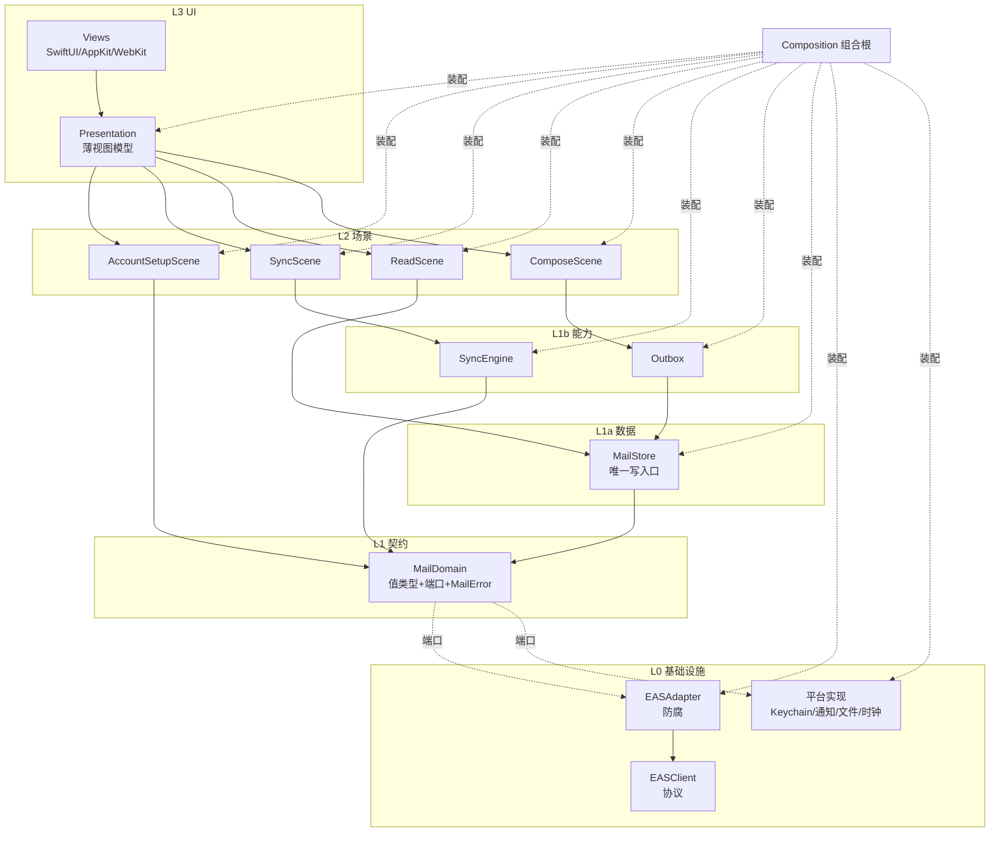

# W-SCN-REFACTOR 架构规格（P1，第二轮评审稿）

> 对应工序 `doc/works/2026-11-10-scene-refactor/`。本稿是第一轮边界确认后的完整规格：模块卡、依赖矩阵、契约卡、冷热路径卡、数据所有权、验证计划与走查结果。**确认后冻结**：模块卡与契约卡并入 `design/architecture.md` 与 `design/components/*/spec.md`，本目录归档进 `history/works/`。

## 0. 结论

- 以**场景**为 L2 唯一收口：4 个场景类，每条业务流的上层组合只住在一个类里。
- 分层：L3 视图/薄视图模型 → L2 场景 → L1b 能力（同步、发件箱）→ L1 端口与值类型 → L1a 数据服务 → L0 基础设施（EAS 协议与防腐）。
- EAS 只出现在 L0：`MailGateway` 端口 7 个操作，错误只在一处映射。
- 发信是唯一改变用户可见时序的点：入队即返回，`Outbox` 冷投递，租约 + 幂等键防双投。
- 组合根（`Composition`）只装配、注入、路由与生命周期，**不承接任何业务逻辑**（D9）。
- 9 个库 target + 2 个可执行 target；`AppServices` 退役。

## 1. 业务能力与约束

### 能力清单

| 能力 | owner 场景 | 触发 | 结果 | 规则/不变量 | 数据 | 失败语义 | 频率 | 冷/热 | 变化可能性 |
|---|---|---|---|---|---|---|---|---|---|
| 账号接入 | `AccountSetupScene` | 用户填表点连接 | 账号 ready + 文件夹树 + 凭据入 Keychain | 顺序固定；失败不留半成品；设备未登记不重试 | accounts、folders、sync_state、Keychain | 分类错误，停在配置页 | 首次/换机 | 冷（用户等待） | 低 |
| 文件夹与收件箱同步 | `SyncScene` | 启动、每 5 分钟、手动刷新 | 本地出现新邮件与新文件夹 | 单飞；批次与 key 同事务；失败保旧数据 | folders、messages、sync_state | 状态栏错误，后台退避 | 每 5 分钟 | 冷 | 中（轮询→Ping） |
| 浏览与阅读 | `ReadScene` | 选文件夹、选邮件 | 列表与正文 | 读路径不触网；缓存优先；缺正文先占位后补拉 | messages、message_bodies | 占位 + 重试入口 | 高频 | 热 | 低 |
| 附件 | `ReadScene` | 点附件 | 本地文件并打开 | 同一附件单飞下载；缓存有预算 | attachments、附件缓存 | 提示失败可重试 | 中 | 冷 | 低 |
| 本地搜索 | `ReadScene` | 输入关键字 | 结果列表 | 本地优先；<3 字符走 LIKE | messages、fts | 空结果/错误提示 | 中 | 热 | 低（未来远端兜底） |
| 撰写/回复/转发 | `ComposeScene` | 新建/回复/转发 | 草稿或入队 | 回复引用规则；发送只入队 | outbox | 入队失败提示；投递失败标红 | 中 | 热（入队） | 低 |
| 投递 | `Outbox` | 入队、启动、重试 | 送达或失败态 | 最多成功一次；租约防并发；永久失败保留内容 | outbox | 退避/标红 | 冷 | 冷 | 低 |
| 新邮件通知 | `SyncScene` | 同步新增 > 0 | 系统通知 | 通知失败不影响同步 | 无 | 静默降级 | 每 5 分钟 | 冷 | 低 |

### 三条变化轴

1. **EAS 网关行为**（状态码、线格式、设备策略）→ 只改 `EASAdapter` / `EASClient`，场景与领域契约不动。
2. **发送通道**（EAS SendMail → 其他）→ 只换 `MailGateway.send` 实现，`Outbox` 状态机不动。
3. **窗口与交互形态**（单窗口 → 多窗口/菜单栏）→ 只改 `Presentation` 与视图。

### 三条不变量

1. UI 读路径不触网：列表、正文命中、搜索都只读本地库。
2. 同一账号同一集合同时只有一个 Sync 在飞；SyncKey 与批次同事务提交。
3. 发送意图不丢、不双发：入队即成功，投递最多成功一次。

### 三个最痛失败

1. SyncKey 失步 → 重信/丢信（对策：原子提交 + 幂等 upsert + status 3/4 重建）。
2. 发送被吞或双发（对策：Outbox 状态机 + 租约 + `ClientId` 幂等键）。
3. 设备未登记被误判为网络问题（对策：单一错误目录 + 场景层不重试规则）。

## 2. 模块地图



### 责任收口表（一句话测试）

| 业务流 | 唯一顶层组合 | 它拥有规则 | 不在别处 |
|---|---|---|---|
| 接入 | `AccountSetupScene.connect` | 验证顺序、失败回滚、错误分类 | 视图不再拼装账号 |
| 收取 | `SyncScene.refresh/startAutoRefresh` | 刷新节奏、单飞、通知条件、失败态 | App 的 `.task` 不再轮询 |
| 阅读 | `ReadScene.open/download` | 缓存优先、补拉落库、附件单飞与预算 | 视图不再决定“先读库还是先拉网” |
| 撰写发送 | `ComposeScene.send/saveDraft` | 回复引用、入队语义、草稿状态 | `ComposeModel` 不再调发送服务 |
| 投递 | `Outbox.flush/retry/cancel` | 状态机、退避、租约、幂等 | 场景不直接发 SMTP/EAS |

### 模块卡

#### CMP-DOMAIN MailDomain（新）

- 状态：planned；单元：模块（组合组件，含值类型 + 端口）；层：L1 契约。
- 业务价值：让场景与数据、协议都只认识一套稳定概念；没有它，每个 target 自带一份值类型，改一个字段要动四处。
- 负责 X：值类型（`Account`、`Folder`、`Message`、`Body`、`Attachment`、`Draft`、`OutboxItem`、`SyncReport`）、端口（`MailGateway`、`SyncStore`、`CredentialStore`、`Notifier`、`AttachmentFiles`、`MailClock`）、`MailError` 目录、`ServerConfiguration`。
- 不负责 Y：任何 I/O、持久化、协议编解码、UI 文案。
- 拥有的数据：无持久数据。
- 变化轴：领域概念本身（邮件、文件夹、发送意图）的字段与语义。
- 公开契约：见 §4.1–§4.3。
- 入口：`Sources/MailDomain/Values.swift#…`、`Ports.swift#…`、`Errors.swift#…`（落地时校验）。
- 依赖：仅 Foundation。扇出 0。
- 冷热：两侧共用；只做值传递。
- 尺寸预算：目标 ≤ 800 行；上限 120k token。
- 单独运行：`./Scripts/swiftw test --filter MailDomainTests`（新增）。
- 删除测试：删掉后 `Scenes`、`MailStore`、`SyncEngine`、`Outbox` 各自定义同名类型并互相转换 → 复杂度集中，是真边界。

#### CMP-STORE MailStore（现有，改造）

- 状态：active；单元：组件；层：L1a 数据服务。
- 负责 X：schema 与迁移、事务、幂等 upsert、分页/列表查询、正文分表、FTS、软删除、outbox 行的物理读写。
- 不负责 Y：网络、协议、MIME、UI 状态、发送状态机（状态机归 `Outbox`）。
- 拥有的数据：`accounts`、`folders`、`messages`、`message_bodies`、`attachments`、`sync_state`、`outbox`、`fts`（唯一写入口）。
- 变化轴：存储引擎与查询形态（GRDB → 其他）。
- 公开契约：§4.4（v2 delta）；同时直接遵循 `SyncStore` 端口（删除 `StoreAdapter`）。
- 入口：`Sources/MailStore/MailStore.swift#MailStore`。
- 依赖：`MailDomain`（值类型与 `SyncStore`）、GRDB。扇出 2。
- 冷热：读热、写冷热混合；`DatabaseQueue` 单写。
- 尺寸预算：当前 637 行；目标 ≤ 900 行；上限 120k token。
- 单独运行：`./Scripts/swiftw test --filter MailStoreTests`。
- 删除测试：删掉后场景、同步、搜索各自拼 SQL 并各自维护 SyncKey → 复杂度分散，是真边界。

#### CMP-SYNC SyncEngine（现有，改层次与端口）

- 状态：active；单元：组件；层：**L1b 能力**（原 L2，本次下调）。
- 负责 X：Provision 前置、FolderSync、集合 Sync 分页、SyncKey 推进、status 3/4 重建、`throttled` 重试一次。
- 不负责 Y：刷新节奏、通知、UI 状态、MIME、数据库 schema。
- 拥有的数据：无持久业务数据；内存状态机 `SyncState`。
- 变化轴：服务器分页/限流行为（沉在 gateway 之下）；触发方式由场景决定。
- 公开契约：§4.5；`syncOnce()` 与 `currentState()` 保持；`start/stop/stateStream` 不实现（轮询归 `SyncScene`）。
- 入口：`Sources/SyncEngine/SyncEngine.swift#SyncEngine`。
- 依赖：`MailDomain`（`MailGateway`、`SyncStore`）。扇出 2。
- 冷热：冷；每账号一个 actor。
- 尺寸预算：当前 151 行；目标 ≤ 400 行。
- 单独运行：`./Scripts/swiftw test --filter SyncEngineTests`。
- 删除测试：删掉后 `SyncScene` 直接编排网关并各自维护 SyncKey → 复杂度集中，是真边界。

#### CMP-OUT Outbox（新，从 MailService 抽出）

- 状态：planned；单元：组件；层：L1b 能力。
- 业务价值：发送意图不因断网或进程重启丢失，且最多成功一次。
- 负责 X：入队、租约领取、MIME 组装调用、投递、失败分类、退避、重试、取消、状态查询。
- 不负责 Y：撰写编辑与引用规则（`ComposeScene`）、协议（`MailGateway`）、outbox 行存储（`MailStore`）。
- 拥有的数据：`outbox` 状态机语义（行由 `MailStore` 物理持有）。
- 变化轴：发送通道（换 `MailGateway.send` 实现即可）。
- 公开契约：§4.6。
- 入口：`Sources/Outbox/Outbox.swift#Outbox`、`MimeBuilder.swift#MimeBuilder`。
- 依赖：`MailDomain`、`MailStore`。扇出 2。
- 冷热：入队热（本地事务）、投递冷（独立 actor + 定时泵）。
- 尺寸预算：目标 ≤ 500 行；上限 120k token。
- 单独运行：`./Scripts/swiftw test --filter OutboxTests`（新增）。
- 删除测试：删掉后场景直连 SendMail，断网丢信、重启重发、并发双发 → 复杂度集中，是真边界。

#### CMP-EASADAPTER EASAdapter（新）

- 状态：planned；单元：组件（技术边界 / 防腐层）；层：L0。
- 业务价值：把 EAS 的类型、错误与配置挡在领域契约之外；协议升级只改这一处。
- 负责 X：实现 `MailGateway`；`EASConfiguration` 构造；`EASError` → `MailError` 映射；MIME 以 opaque 字节送出。
- 不负责 Y：业务判断、重试策略、持久化、UI。
- 拥有的数据：无。
- 变化轴：EAS 协议版本与网关差异。
- 公开契约：`MailGateway` v2 的唯一生产实现。
- 入口：`Sources/EASAdapter/EASAdapter.swift#EASAdapter`。
- 依赖：`MailDomain`、`EASClient`。扇出 2。
- 冷热：冷。
- 尺寸预算：目标 ≤ 300 行。
- 单独运行：`./Scripts/swiftw test --filter EASAdapterTests`（新增，用 `EASHTTPTransport` 替身）。
- 删除测试：删掉后场景与同步各写一遍错误映射与类型转换 → 复杂度分散且错误语义不一致，是真边界。

#### CMP-SCN-ACCOUNT AccountSetupScene（新）

- 状态：planned；单元：组件；层：L2 场景。
- 负责 X：接入流程编排（probe → provision → folderSync → 建账号 → 快照 → ready → 存凭据）、失败回滚、错误分类呈现入口。
- 不负责 Y：表单校验样式、Keychain 细节、协议细节。
- 拥有的数据：无；账号行由 `MailStore` 写、凭据由 `CredentialStore` 写。
- 变化轴：接入步骤顺序与校验项。
- 公开契约：§4.7。
- 入口：`Sources/Scenes/AccountSetupScene.swift#AccountSetupScene`。
- 依赖：`MailDomain`（gateway/credential/store 契约）、`MailStore`。扇出 2。
- 冷热：冷（用户等待一次）。
- 单独运行：`./Scripts/swiftw test --filter ScenesTests`。
- 删除测试：删掉后视图或 CLI 各自拼接入流程，失败回滚不一致 → 复杂度集中，是真边界。

#### CMP-SCN-SYNC SyncScene（新）

- 状态：planned；单元：组件；层：L2 场景。
- 负责 X：手动/自动刷新的节奏与单飞、通知条件、失败态到场景结果的映射、授权请求。
- 不负责 Y：SyncKey、分页、退避细算（`SyncEngine`）；通知 UI（`Notifier` 实现）。
- 拥有的数据：内存中的刷新状态与自动刷新任务（生命周期归本组件）。
- 变化轴：刷新触发方式（轮询 → Ping）与通知策略。
- 公开契约：§4.8。
- 入口：`Sources/Scenes/SyncScene.swift#SyncScene`。
- 依赖：`SyncEngine`、`MailDomain`（`Notifier`、`MailClock`）。扇出 1 + 端口。
- 冷热：冷；不与主线程共享。
- 删除测试：删掉后视图自己起轮询、自己判通知 → 节奏规则散落在 UI，是真边界。

#### CMP-SCN-READ ReadScene（新）

- 状态：planned；单元：组件；层：L2 场景。
- 负责 X：文件夹/列表/搜索读取、正文“缓存优先 + 补拉落库”、附件下载与单飞、补拉被删的丢弃规则。
- 不负责 Y：选择状态与格式化（`Presentation`）、协议、缓存目录细节。
- 拥有的数据：无持久数据；在飞请求集合（内存）。
- 变化轴：读取策略（是否远端兜底搜索、附件预览）。
- 公开契约：§4.9。
- 入口：`Sources/Scenes/ReadScene.swift#ReadScene`。
- 依赖：`MailStore`、`MailDomain`（`MailGateway`、`AttachmentFiles`）。扇出 2 + 端口。
- 冷热：读热、补拉/附件冷。
- 删除测试：删掉后视图与 VM 各自决定读库/拉网与落库 → 规则散落，是真边界。

#### CMP-SCN-COMPOSE ComposeScene（新）

- 状态：planned；单元：组件；层：L2 场景。
- 负责 X：新建/回复/转发种子、草稿保存、发送入队、待发列表与重试/取消入口。
- 不负责 Y：编辑器 UI、MIME 细节、投递（`Outbox`）。
- 拥有的数据：无持久数据；草稿文本由 `Presentation` 持有。
- 变化轴：撰写形态（纯文本/富文本、附件）。
- 公开契约：§4.10。
- 入口：`Sources/Scenes/ComposeScene.swift#ComposeScene`。
- 依赖：`MailStore`、`Outbox`、`MailDomain`。扇出 2。
- 冷热：热（入队本地事务）。
- 删除测试：删掉后视图直接操作 outbox 并拼 MIME → 规则散落，是真边界。

#### CMP-PRES Presentation（新）

- 状态：planned；单元：模块；层：L3 表现。
- 负责 X：可观察状态（`@MainActor @Observable`）、选择与导航、格式化（日期/发件人/文案）、把场景结果映射为视图状态、系统动作（打开文件）。
- 不负责 Y：业务规则、直接访问 `MailStore`/`MailGateway`/`Outbox`。
- 拥有的数据：视图状态（选择、搜索词、加载态），不持久化。
- 变化轴：窗口形态与交互。
- 公开契约：§4.11。
- 入口：`Sources/Presentation/AccountSetupViewModel.swift`、`MailboxViewModel.swift`、`ComposeViewModel.swift`。
- 依赖：`Scenes`、`MailDomain`、Observation。扇出 1。
- 冷热：热（主线程）。
- 删除测试：删掉后视图直接持有场景并写展示逻辑，测试无法覆盖状态机 → 复杂度集中，是真边界。

#### CMP-APP AppShell（现有，收敛）

- 状态：active；单元：组件；层：L3 UI。
- 负责 X：窗口、导航、列表/阅读/撰写渲染、WebView 安全策略。
- 不负责 Y：编排、状态机、格式化规则、服务装配。
- 拥有的数据：无。
- 公开契约：无（只依赖 `Presentation`）。
- 入口：`Sources/uumail/*.swift`。
- 依赖：`Presentation`、SwiftUI/AppKit/WebKit。扇出 1。
- 冷热：热。
- 删除测试：删掉则无产品。

#### CMP-CLI uumailctl（现有，收敛）

- 状态：active；单元：组件；层：L3（交付入口）。
- 负责 X：诊断命令（`options/provision/ping`）、数据命令（`folders/sync/send/seed`）、退出码。
- 不负责 Y：业务编排（调场景）、UI。
- 公开契约：命令行参数与退出码。
- 入口：`Sources/uumailctl/UumailCtl.swift`。
- 依赖：`Composition`、`MailDomain`；诊断命令允许直连 `EASClient`（见 §3 例外）。
- 冷热：冷。
- 删除测试：删掉后真机排障与端到端验证无入口。

#### CMP-ROOT Composition（新）

- 状态：planned；单元：组件；层：根（装配 **与路由**）。
- 业务价值：把“谁依赖谁、谁先启动”集中到一处；**只转发与路由**，让业务判断留在场景里。
- 负责 X：读配置（Keychain / DEBUG 环境）、构造依赖、注入端口、把入口请求路由到对应场景/视图模型、持有并启停长生命周期任务（自动刷新、投递泵）。
- 不负责 Y：任何业务判断与流程编排——不判账号状态、不判 outbox/同步结果、不映射业务错误、不重试、不格式化、不读写业务数据。
- 拥有的数据：无持久数据；只持有进程级任务句柄与已构造对象。
- 变化轴：部署形态（App/CLI）、平台实现替换。
- 公开契约：`AppComposition.make(environment:)` / `makeForDebug(environment:)`，返回已装配对象；不暴露业务操作。
- 入口：`Sources/Composition/AppComposition.swift`（装配与路由）、`Platform/*.swift`（适配器实现，不含业务规则）。
- 依赖：其余所有库 target。作为组合根豁免扇出限制（实际 9）。
- 冷热：启动一次；运行期只做路由，不进热路径。
- 尺寸预算：`AppComposition` 目标 ≤ 200 行；平台适配器各自 ≤ 120 行；上限 120k token。
- 单独运行：`./Scripts/swiftw test --filter CompositionTests`（只做装配冒烟，不测业务）。
- 删除测试：删掉后各入口各自装配，环境分支散落 → 真边界。
- **禁入清单**（详见 §7）：`switch`/`if` 业务状态、调用 `MailGateway`/`Outbox`/`SyncEngine`/`MailStore` 的业务方法、retry/sleep 循环、错误文案映射、`MailStore` 查询/写入（路径初始化与存在性检查除外）。

#### 平台实现（归 CMP-ROOT target 内，不单列 target）

`KeychainCredentialStore`（实现 `CredentialStore`）、`SystemNotifier`（实现 `Notifier`）、`FileAttachmentFiles`（实现 `AttachmentFiles`）、`SystemMailClock`（实现 `MailClock`）、`AppPaths`。各自 ≤120 行，只做平台翻译；它们是**适配器组件**，不是组合根本身，同样不得含业务规则。若文件数超过 5 个或出现业务判断，拆出独立 `Platform` target（需重新定级）。

#### 平台实现（归 CMP-ROOT 内，不单列 target）

`KeychainCredentialStore`（实现 `CredentialStore`）、`SystemNotifier`（实现 `Notifier`）、`FileAttachmentFiles`（实现 `AttachmentFiles`）、`SystemMailClock`（实现 `MailClock`）、`AppPaths`。各自 ≤120 行，只做平台翻译。

### 能力所有权矩阵

| 业务能力 | owner | 规则落点 | 数据写入口 | 备注 |
|---|---|---|---|---|
| 账号接入 | `AccountSetupScene` | 该场景 | `MailStore` + `KeychainCredentialStore` | 失败回滚 `discardAccount` |
| 同步 | `SyncScene` | 节奏/通知在该场景；key/分页在 `SyncEngine` | `MailStore`（经 `SyncEngine`） | 单一 owner |
| 阅读 | `ReadScene` | 该场景 | `MailStore` | 正文落库只在此 |
| 搜索 | `ReadScene` | 该场景 | 只读 | 未来远端兜底仍在此扩展 |
| 撰写/发送意图 | `ComposeScene` | 引用规则 | `MailStore.enqueueOutbox`（经 `Outbox`） | 入队后不再回滚 |
| 投递 | `Outbox` | 该组件 | `MailStore.claimOutbox/markOutbox*` | 场景不投递 |
| 通知 | `SyncScene` | 该场景 | 无 | 端口实现归 Composition |
| 展示 | `Presentation` | 文案/格式化 | 无 | 不写业务数据 |

## 3. 依赖矩阵

| 调用方 | 被调方 | 契约 | 方式 | 路径 | 失败处理 | 备注 |
|---|---|---|---|---|---|---|
| `Views` | `Presentation` | VM 属性与方法 | 同步 + 绑定 | 热 | 展示错误文案 | 视图不 import 场景 |
| `MailboxViewModel` | `SyncScene` | `refresh`/`autoRefresh` | 异步 + 流 | 冷 | 状态栏 + 保留缓存 | 单飞在场景内 |
| `MailboxViewModel` | `ReadScene` | `open`/`download`/`search` | 异步 + 流 | 热/冷 | 占位 + 重试 | 读路径不经网络（命中） |
| `MailboxViewModel` | `ComposeScene` | `send`/`seeds` | 同步 + 异步 | 热 | 入队失败提示 | 发送不再等待网络 |
| `AccountSetupViewModel` | `AccountSetupScene` | `connect` | 异步 | 冷 | 分类错误停在表单 | 不做半成品 |
| `ComposeViewModel` | `ComposeScene` | `send`/`saveDraft` | 同步 + 异步 | 热 | 失败保留编辑内容 | — |
| `AccountSetupScene` | `MailGateway` | `probe/provision/fetchFolders` | 异步 | 冷 | 分类错误、回滚 | — |
| `AccountSetupScene` | `CredentialStore` | `save` | 同步 | 冷 | 失败回滚账号 | — |
| `SyncScene` | `SyncEngine` | `syncOnce` | 异步 | 冷 | 退避/状态映射 | 单飞 |
| `SyncScene` | `Notifier` | `postNewMail` | 异步 | 冷 | 静默降级 | 不阻塞刷新 |
| `ReadScene` | `MailStore` | 读契约 + `applyBody` | 同步 | 热/冷 | 错误上抛 | 落库在 yield 前 |
| `ReadScene` | `MailGateway` | `fetchBody/fetchAttachment` | 异步 | 冷 | `MailError` | 取消即停 |
| `ReadScene` | `AttachmentFiles` | `store/url` | 同步 | 冷 | 磁盘错误上抛 | LRU 归实现 |
| `ComposeScene` | `Outbox` | `enqueue` | 同步 | 热 | 校验/存储错误 | 事务内 |
| `Outbox` | `MailGateway` | `send(mime,clientID)` | 异步 | 冷 | 分类重试/永久失败 | 租约 |
| `Outbox` | `MailStore` | `claim/mark*` | 同步 | 冷 | 状态回滚 | 行级状态机 |
| `SyncEngine` | `MailGateway` | v2 读契约 | 异步 | 冷 | 状态机 | — |
| `SyncEngine` | `MailStore`（`SyncStore`） | 批次/快照/key | 同步 | 冷 | 整批回滚 | 直接遵循端口，无适配器 |
| `EASAdapter` | `EASClient` | EAS 命令 | 异步 | 冷 | `EASError → MailError` | 唯一映射点 |
| `Composition` | 全体 | 构造 + 端口注入 + 入口路由 | 同步 | 启动/路由 | 装配失败显示配置页 | 唯一装配点；只转发，不含业务判断 |

### 禁止边

| 禁止 | 守门方式 |
|---|---|
| `Scenes`/`Presentation` → `EASClient`/`EASAdapter` | import 白名单脚本 |
| `Presentation`/`Views` → `MailStore`/`SyncEngine`/`Outbox` | import 白名单脚本 |
| `Views` → `Scenes` | import 白名单脚本 |
| `MailStore` → `MailGateway`/`EASClient` | import 白名单脚本 |
| L1 → L2、同层横向互调（场景之间直接调用） | import 图 + 评审 |
| 任何模块内用环境变量挑选实现 | 组合根唯一；review |
| `Composition` 调业务方法/判业务状态 | 架构脚本：禁 `MailStore` 业务契约、`MailError`/`SyncState`/`OutboundState` 的 switch；行数上限 200 |

**例外（显式登记）**：`uumailctl` 的 `options/provision/ping` 诊断命令允许直接 import `EASClient`，因为它们是协议探针而非业务流；脚本对该 target 放行 `EASClient`，但 `sync/send/folders/seed` 必须走场景。

### 扇出与扇入

| 模块 | 扇出 | 预算 | 说明 |
|---|---|---|---|
| `MailDomain` | 0 | ≤5 | 纯契约 |
| `MailStore` | 2 | ≤4 | Domain + GRDB |
| `SyncEngine` | 2 | ≤5 | Gateway + Store |
| `Outbox` | 2 | ≤4 | Store + Gateway（MIME 内部） |
| `EASAdapter` | 2 | ≤5 | Domain + EASClient |
| 每个场景 | 1–2 + 端口 | ≤5 | 端口计入 Domain 不重复计 |
| `Presentation` | 1 | ≤3 | 只依赖 Scenes |
| `Composition` | 9 | 豁免 | 组合根 |

扇入：`MailDomain` 被全部模块依赖（平台级 → 契约评审、兼容性测试）；`MailStore` 扇入 5（平台级 → 写契约变更按 P1）；`Scenes` 被 `Presentation` 与 `uumailctl` 依赖（2）。

## 4. 契约卡

### 4.1 MailGateway v2（L1 端口）

- 所属：`MailDomain`；目的：把服务器能力以本方概念提供给场景与同步。
- 签名：
  ```swift
  public protocol MailGateway: Sendable {
      func probe() async throws -> ServerCapabilities
      func provisionIfNeeded() async throws
      func fetchFolders(syncKey: String) async throws -> FolderListing
      func fetchMessages(collectionID: String, syncKey: String, window: Int, filterType: Int) async throws -> MessageDelta
      func fetchBody(collectionID: String, serverID: String) async throws -> String
      func fetchAttachment(fileReference: String) async throws -> Data
      func send(mime: Data, clientID: String) async throws
  }
  ```
- 不变量：不泄漏 EAS 类型/字符串状态码；`send` 成功当且仅当服务器返回 200 且 0 字节 body；`fetchFolders(syncKey:"0")` 返回全量树。
- 错误模式（唯一目录 `MailError`）：
  | 来源 | `MailError` | 可重试 | 调用方应对 |
  |---|---|---|---|
  | 401 | `authFailed` | 否 | 回凭据输入，不自动重试 |
  | 200 空 body / 写命令 401 | `deviceNotRegistered` | 否 | 展示登记指引，停止重试 |
  | 449 / 策略拒绝 | `policyBlocked` | 否 | 提示策略，保留本地数据 |
  | Sync 3/4 | `syncKeyInvalid` | 是（重建） | 清集合后全量 |
  | 503 + Retry-After | `throttled(seconds)` | 是 | 按值退避 |
  | 连接失败/超时 | `offline` | 是 | 退避 |
  | 444 / 502 / 坏 WBXML / 永久 4xx | `unsupported` | 否 | 记录并提示协议问题 |
- 幂等：`send` 以 `clientID` 为幂等键；读操作无副作用。
- 超时/取消：单命令 60s；`send` 90s；取消传播到 URLSession。
- 一致性：单请求语义，不保证跨命令一致。
- 兼容性：v2 在 v1 基础上新增 `probe/fetchBody/fetchAttachment/send`；旧 `EASGateway` 删除。
- 契约测试：错误映射表驱动；200 空 body → `deviceNotRegistered`；`send` 200+0B 成功；坏 WBXML → `unsupported`。

### 4.2 SyncStore（L1 端口，`MailStore` 直接遵循）

```swift
public protocol SyncStore: Sendable {
    func folders(_ account: AccountID) throws -> [Folder]
    func applyFolderSnapshot(_ account: AccountID, folders: [Folder], syncKey: String) throws
    func syncKey(_ account: AccountID, collection: String) throws -> String?
    func applySyncBatch(_ account: AccountID, folder: String, delta: MessageDelta) throws
    func resetCollection(_ account: AccountID, folder: String) throws
}
```

- 变更：去掉 `async`（本地库同步调用）；`AccountRef` 并入 `AccountID`；`StoreAdapter` 删除。
- 不变量：批次与 key 同事务；失败不推进 key；`(account, folder, serverID)` 幂等。
- 兼容性：破坏性变更，`SyncEngine` 与测试同步改；无外部调用方。

### 4.3 平台端口（`MailDomain`）

```swift
public protocol CredentialStore: Sendable {
    func load() throws -> ServerConfiguration?
    func save(_ configuration: ServerConfiguration) throws
    func delete() throws
}
public protocol Notifier: Sendable {
    func requestAuthorization() async
    func postNewMail(count: Int) async
}
public protocol AttachmentFiles: Sendable {
    func cachedURL(for reference: AttachmentRef) -> URL?
    func store(_ data: Data, for reference: AttachmentRef) throws -> URL
}
public protocol MailClock: Sendable {
    var now: Date { get }
    func sleep(for duration: Duration) async throws
}
```

- 不变量：端口实现不得反向依赖场景；`AttachmentFiles.store` 原子写并执行预算淘汰（2GB LRU，Q2 默认）。
- 错误模式：`MailError.storage(reason:)`、`invalidInput(reason:)`；凭据错误不吞。
- 测试：每个实现用临时目录/内存替身；`MailClock` 替身让轮询测试即时。

### 4.4 MailStore v2（delta）

新增/变更（其余保持）：

```swift
func discardAccount(_ id: AccountID) throws           // 仅当无消息；删 folders/sync_state/account
func markAccountReady(_ id: AccountID) throws
func claimOutbox(account: AccountID, now: Date, lease: Duration) throws -> OutboxItem?
func markOutboxSent(account: AccountID, outboxID: OutboxID) throws
func markOutboxFailed(account: AccountID, outboxID: OutboxID, error: String,
                      retryable: Bool, nextAttempt: Date?) throws
func releaseOutbox(account: AccountID, outboxID: OutboxID) throws
func cancelOutbox(account: AccountID, outboxID: OutboxID) throws
func outboxItem(account: AccountID, id: OutboxID) throws -> OutboxItem?
```

- schema v2（增量迁移，可前滚）：`outbox` 增加 `sending_since REAL NULL`、`next_attempt_at REAL NULL`；`state` 取值扩展为 `draft/queued/sending/failed_retryable/failed_permanent/canceled`（旧 `failed` → `failed_retryable`）。
- 不变量：`claimOutbox` 只领取 `queued`、到期的 `failed_retryable` 与租约过期的 `sending`；领取即写 `sending` 与 `sending_since`，同一条语句完成（`UPDATE … RETURNING`），并发进程不双领。
- 错误：`MailStoreError` 扩展 `outboxNotClaimable`、`accountNotEmpty`。
- 并发：单写队列；跨进程靠 SQL 原子更新。
- 兼容性：`StoredMessage/StoredFolder/StoredAttachment/MailMessage/MailFolder/MailDraft/StoredOutboxItem` 以 `typealias` 指向 Domain 新名字，两阶段清理。

### 4.5 SyncEngine v1（delta）

- 签名不变：`syncOnce() async throws -> SyncReport`、`currentState() -> SyncState`。
- 变更：`store` 参数类型为 `any SyncStore`（不再 `StoreAdapter`）；错误上抛 `MailError`（原 `MailGatewayError` 合并进 `MailError`）。
- 不变量：同账号串行（actor）；`throttled` 最多重试一次；失败保留旧 key。
- 契约测试：保留现有 6 个用例，错误类型断言替换。

### 4.6 Outbox v1

- 所属：`Outbox`；目的：发送意图的持久化与最多一次成功投递。
- 签名：
  ```swift
  public actor Outbox {
      public func enqueue(_ draft: Draft, account: AccountID) throws -> OutboxID
      public func flushOnce(account: AccountID) async -> DeliveryOutcome?   // 领一条并投递
      public func flushAll(account: AccountID) async -> [DeliveryOutcome]   // CLI/启动补投
      public func retry(_ id: OutboxID, account: AccountID) throws
      public func cancel(_ id: OutboxID, account: AccountID) throws
      public func state(of id: OutboxID, account: AccountID) throws -> OutboundState?
      public func pending(account: AccountID) throws -> [OutboxItem]
  }
  ```
- 状态机：`queued → sending → sent | failed_retryable | failed_permanent`；`canceled` 只从 `queued/failed_*` 进入；`sending` 持租约 120s。
- 不变量：`enqueue` 只写本地行并立即返回；`ClientId = outboxID`；成功即删行；永久失败保留内容与原因；重启后 `sending` 过期行可被重新领取（幂等键防双发）。
- 错误分类：`offline/throttled` → 可重试，退避 30s→2m→10m→30m，上限 24h；`authFailed/deviceNotRegistered/policyBlocked/unsupported` → 永久失败（手动重试才再投）。
- 并发：每账号一个 `Outbox` actor；跨进程租约；`flushOnce` 无行时返回 nil。
- 超时/取消：`send` 90s；取消在 `sending` 中仅置标记，投递返回后落终态。
- 观测：`pending` 计数、最近失败原因、下次尝试时间（由场景/VM 读取）。
- 契约测试：状态机表驱动、租约过期重领、离线入队恢复后只成功一次、永久失败不自动重试。

### 4.7 AccountSetupScene

```swift
public struct AccountSetupScene: Sendable {
    public init(gateway: any MailGateway, store: MailStore, credentials: any CredentialStore)
    public func validate(_ input: AccountInput) async throws        // probe + provision
    public func connect(_ input: AccountInput) async throws -> ConnectedAccount
}
public struct AccountInput: Sendable { host, account, password, domain, deviceID, displayName }
public struct ConnectedAccount: Sendable { accountID, address, displayName, folders }
```

- 不变量：`connect` 顺序固定；任一步失败不留账号行（`discardAccount`）；凭据最后写；`validate` 不写库。
- 错误：透传 `MailError`；`invalidInput` 用于空字段；`storage` 用于回滚失败。
- 幂等：重复 `connect` 同一账号成功时复用既有账号（`existingOrNewAccount` 规则移入此场景）。
- 并发：单次用户操作；不做并发保护（组合根串行）。
- 契约测试：T-SCN-0001-01/02/03/04；失败回滚断言账号数不变。

### 4.8 SyncScene

```swift
public struct RefreshOutcome: Sendable { report: SyncReport?, error: MailError?, at: Date }
public actor SyncScene {
    public func refresh() async -> RefreshOutcome
    public func startAutoRefresh(every: Duration = .seconds(300)) -> AsyncStream<RefreshOutcome>
    public func stopAutoRefresh()
}
```

- 不变量：单飞（并发 `refresh` 复用同一在飞结果）；通知只在 `added > 0` 且授权成功时发；`authFailed/deviceNotRegistered/policyBlocked` 暂停自动刷新；通知失败不影响结果。
- 错误：`RefreshOutcome.error` 分类透传；自动刷新不停机（除上述三类）。
- 超时/取消：取消 `AsyncStream` 消费者即停止自动刷新任务。
- 一致性：刷新返回后本地库已提交；VM 读库即可见。
- 契约测试：单飞（两次并发只调一次 `syncOnce`）、通知条件、失败保留旧数据、暂停规则。

### 4.9 ReadScene

```swift
public struct MessageRef: Hashable, Sendable { folderID, serverID }
public enum BodyEvent: Sendable { case cached(String), loaded(String), failed(MailError) }
public struct ReadScene: Sendable {
    public func folders() throws -> [Folder]
    public func messages(folderID: String, limit: Int = 200) throws -> [Message]
    public func search(_ query: String, limit: Int = 100) throws -> [Message]
    public func attachments(for ref: MessageRef) throws -> [Attachment]
    public func bodyIfCached(_ ref: MessageRef) throws -> String?
    public func open(_ ref: MessageRef) -> AsyncStream<BodyEvent>
    public func downloadAttachment(_ attachment: Attachment, in ref: MessageRef) async throws -> URL
}
```

- 不变量：`folders/messages/search/attachments/bodyIfCached` 零网络；`open` 先 yield `cached`（若有），补拉成功先 `applyBody` 再 yield `loaded`；补拉失败 yield `failed` 且不覆盖缓存；同一 `MessageRef` 的 `open` 单飞。
- 错误：读库错误直接抛；网关错误包装为 `MailError`；取消不落库、不 yield。
- 超时/取消：`onTermination` 取消补拉任务。
- 一致性：yield `loaded` 时库已可读（重复打开命中缓存）。
- 契约测试：T-SCN-0004-02/04、T-SCN-0005；缓存命中不发网络（fake gateway 计数为 0）。

### 4.10 ComposeScene

```swift
public struct ComposeScene: Sendable {
    public func replySeed(to message: Message, bodyHTML: String?) -> Draft
    public func forwardSeed(from message: Message, bodyHTML: String?) -> Draft
    public func saveDraft(_ draft: Draft, account: AccountID) throws -> OutboxID
    public func send(_ draft: Draft, account: AccountID) throws -> OutboxID
    public func pending(account: AccountID) throws -> [OutboxItem]
    public func retry(_ id: OutboxID, account: AccountID) async throws
    public func cancel(_ id: OutboxID, account: AccountID) async throws
}
```

- 不变量：`send` 不开网络，返回即本地事务已提交；空收件人 → `invalidInput`；回复主题前缀与引用文本规则在此；`saveDraft` 不入队。
- 错误：`storage`、`invalidInput`；投递错误不在此返回（异步经 `Outbox` 状态）。
- 契约测试：T-SCN-0006-02（离线入队）、T-SCN-0006-04（幂等单发）、空收件人拒绝、回复/转发种子规则。

### 4.11 Presentation

```swift
@MainActor @Observable public final class MailboxViewModel {
    public private(set) var folders: [Folder]
    public private(set) var messages: [Message]
    public private(set) var body: BodyPresentation   // none/loading/loaded(html)/failed(text)
    public private(set) var attachments: [Attachment]
    public private(set) var sync: SyncPresentation   // idle/syncing/failed(text)/lastSyncedAt
    public var selection: Selection                   // folderID/messageID/searchQuery
    public func refresh() async
    public func select(folderID: String)
    public func select(messageID: String)
    public func openSelected() async
    public func search(_ query: String) async
    public func download(_ attachment: Attachment) async -> URL?
    public func composeNew() -> ComposeViewModel
    public func composeReply() -> ComposeViewModel?
    public func composeForward() -> ComposeViewModel?
}
```

- 不变量：不 import 场景之外的逻辑层类型；文案映射集中在此；选择变化只触发必要的场景调用；同一邮件不重复打开。
- 错误：把 `MailError` 映射为中文文案（单一映射表）。
- 契约测试：现有 `MailboxModelTests` 迁移为 VM 测试（fake scenes 或真场景 + fake gateway）。

## 5. 冷热路径卡

### P1 阅读（命中缓存）— 热

- 触发：选中邮件；频率：高频；SLA：点击到正文 < 1s（1 万封基线）。
- 模块：View → VM → `ReadScene.bodyIfCached`/`open` → `MailStore.body`。
- 同步依赖：0。失败：显示错误与重试；不阻塞列表。
- 超时：无网络调用。资源：主线程只做状态更新，DB 读在存储队列。
- 一致性：强（本地）。
- 观测：`open` 到渲染的耗时（手测基线）。

### P2 阅读（缺正文）— 冷

- 触发：`bodyIfCached == nil`；经过：`ReadScene.open` → `MailGateway.fetchBody` → `MailStore.applyBody` → yield。
- 同步依赖：1（gateway）。失败：`failed(MailError)`，保留占位；重试入口。
- 超时：60s；取消：消费者取消即停，不落库。幂等：同一 ref 单飞。
- 资源：与同步共享 URLSession，但并发上限 1（阅读补拉）。
- 一致性：先落库再通知 UI（读己之写）。

### P3 发送入队 — 热

- 触发：点发送；经过：VM → `ComposeScene.send` → `Outbox.enqueue` → `MailStore.enqueueOutbox`。
- 同步依赖：0。SLA：< 100ms。失败：返回错误，编辑内容保留。
- 幂等：每次点击生成新 outboxID；重复点击由 UI 禁用（`canSend`）。

### P4 投递 — 冷

- 触发：启动、入队后、重试；频率：低。
- 经过：`Outbox.flushOnce` → `claimOutbox` → `MimeBuilder` → `MailGateway.send` → `markOutboxSent/markOutboxFailed`。
- 同步依赖：1。失败：可重试退避；永久失败标红。
- 超时 90s；租约 120s；跨进程幂等（ClientId）。
- 资源：独立 actor，不与同步共享队列；`flushOnce` 只在有行时动。
- 一致性：成功即删行；失败保留原因与下次时间。
- 观测：`pending` 计数、attempts、lastError。

### P5 同步刷新 — 冷

- 触发：启动、每 5 分钟、手动；经过：`SyncScene.refresh` → `SyncEngine.syncOnce` → gateway → `MailStore`。
- 同步依赖：1。失败：保留旧数据，状态栏错误；`authFailed` 等暂停自动刷新。
- 超时：单命令 60s；退避由 `SyncEngine`（throttled 一次）与 `SyncScene`（节奏）分担。
- 资源：单账号 actor，与 UI 隔离。
- 观测：`lastSyncedAt`、`SyncReport`、失败态。

### P6 附件下载 — 冷

- 触发：点附件；经过：`ReadScene.downloadAttachment` → 缓存命中/`fetchAttachment` → `AttachmentFiles.store` → `markAttachmentCached`。
- 同步依赖：1。失败：抛 `MailError`，UI 提示可重试。
- 幂等：同一 `imageRef` 单飞；缓存命中不发网络。
- 资源：并发上限 3；缓存 2GB LRU（Q2）。
- 一致性：先写文件再标记路径；标记失败不回滚文件（可重下）。

## 6. 数据所有权矩阵

| 实体 | 所有者（唯一写入口） | 写契约 | 读方/投影 | 一致性/延迟 | 迁移归属 |
|---|---|---|---|---|---|
| accounts | `MailStore` | `createAccount/markAccountReady/discardAccount` | `AccountSetupScene`、`Composition` | 强 | `MailStore` |
| folders | `MailStore` | `applyFolderSnapshot` | `ReadScene`、`SyncEngine` | 强 | `MailStore` |
| messages | `MailStore` | `applySyncBatch` | `ReadScene`、`SyncScene` | 强 | `MailStore` |
| message_bodies | `MailStore` | `applyBody`（经 `ReadScene`/`SyncEngine`） | `ReadScene` | 强 | `MailStore` |
| attachments | `MailStore` | `markAttachmentCached` + `applySyncBatch` | `ReadScene` | 强 | `MailStore` |
| sync_state | `MailStore` | `applySyncBatch/applyFolderSnapshot/resetCollection` | `SyncEngine` | 强 | `MailStore` |
| outbox | `MailStore`（物理行）/ `Outbox`（状态机） | `enqueueOutbox/claimOutbox/markOutbox*` | `ComposeScene`、`Outbox`、VM | 强（本地） | `MailStore` |
| fts | `MailStore` | 随 `applyBody/applySyncBatch` 增量 | `ReadScene.search` | 最终（同事务） | `MailStore` |
| Keychain 凭据 | `CredentialStore` 实现 | `save/delete` | `Composition`、`AccountSetupScene` | 强 | 系统 |
| 附件文件 | `AttachmentFiles` 实现 | `store` | `ReadScene` | 强（文件系统） | 本地 |

**未建**：`pending_op`（已读/移动/删除的本地意图）— 本次只登记扩展点，不建表。

## 7. 装配、复用与组合根

### 组合根

```
AppComposition
├─ environment: ProcessInfo + Keychain 读取
├─ AppPaths.database / attachments / logs
├─ MailStore(path:)
├─ EASAdapter(configuration:)         // ServerConfiguration → EASConfiguration
├─ SyncEngine(gateway:store:account:)
├─ Outbox(store:gateway:clock:)
├─ scenes: AccountSetupScene / SyncScene / ReadScene / ComposeScene
├─ viewModels: AccountSetupViewModel / MailboxViewModel
└─ 生命周期：autoRefreshTask、outboxPumpTask（scenePhase 驱动启停）
```

### 组合根：只装配、只路由

组合根（`AppComposition` / `CommandLineComposition`）只允许做三件事：

1. **构造**：读配置，`new` 出 store、gateway、engine、outbox、scenes、view models。
2. **注入**：把端口实现与场景依赖按构造参数传进去；不做类型判断以外的选择。
3. **路由与生命周期**：按“有没有凭据”选择配置页或邮箱页；启动/停止自动刷新与投递泵；把入口动作转给对应场景或 VM。

| 允许 | 禁止 |
|---|---|
| 读 Keychain / 环境配置 | 读/写邮件、文件夹、outbox 等业务数据 |
| 构造对象、传参、持有引用 | 调 `MailGateway` / `SyncEngine` / `Outbox` 的业务方法 |
| `if 有凭据 { 邮箱 } else { 配置页 }` 这类**状态路由** | `switch MailError`、`if report.added > 0`、按 outbox/同步状态分支 |
| `start/stop` 长生命周期任务 | 重试、退避、`sleep`、队列消费逻辑 |
| 选择 App/CLI 形态、DEBUG 配置来源 | 业务错误文案、日期/发件人格式化、MIME 组装 |
| 记录装配失败并退出/显示配置页 | 用环境变量挑业务实现（唯一例外：`UUMAIL_DEBUG_ENV` 只改**配置来源**） |

**腐化信号**（出现任一条即停下重切）：

- `AppComposition` 里出现 `MailStore` 的业务查询/写入（`messages`、`applySyncBatch`、`outbox` 等）。
- 出现业务类型上的 `switch`/`case`（`MailError`、`OutboundState`、`SyncState`）。
- 出现 `for`/`while` + `try await` 的流程（那是场景，不是装配）。
- 行数超过 200，或需要 fake 业务组件才能测。
- 平台适配器里出现“什么时候发通知/什么时候重试”的判断。

**测试面**：组合根只做**装配冒烟**——用 fake gateway/credential/in-memory store 构造一次，断言对象图非空、任务能启停、无网络与 DB 业务调用。业务正确性一律在场景契约测试里证。

### 路由三分：谁转发、谁判断

“派发根”的风险不只存在于 `Composition`。系统里只有三处允许做“分发”，职责必须切干净：

| 层 | 位置 | 只做 | 绝不能做 |
|---|---|---|---|
| 入口路由 | `AppComposition` / `CommandLineComposition` | 选配置来源、构造对象、按入口形态选页面/命令 | 判业务状态、调业务方法、重试 |
| 动作路由 | `MailboxViewModel` / `ComposeViewModel` / `AccountSetupViewModel` | 把用户动作转成一次场景调用，把结果映射为展示状态 | 决定“先读库还是拉网”、判断失败该不该重试、拼 MIME |
| 业务编排 | 4 个场景 | 流程顺序、失败策略、规则 | 装配、平台细节、视图状态 |

若将来引入统一 dispatcher（本次不引入），它只能是一张**动作 → 场景方法**的静态映射表：无状态、无分支、无重试、无结果处理；一旦开始 `switch` 结果或按状态选下一步，就已经是业务编排，必须退回场景。这条规则与 D5 的取舍一致：分发可以薄，判断必须唯一。

- 唯一环境分支点：`DEBUG + UUMAIL_DEBUG_ENV=1` 时从进程环境读取配置（不写 Keychain）；其余走 Keychain。该分支只决定**配置来源**，不决定业务行为。
- CLI 组合根：`CommandLineComposition` 复用同一装配，DB 路径由 `--db` 覆盖（默认与 App 相同会引发双进程冲突，见 §9 Hold-2）。
- 测试组合根：`FakeGateway` + 临时 SQLite + `MailClock` 替身，直接构造场景。

### 复用归位

| 重复项 | 处置 |
|---|---|
| 三套消息结构（`EASMessage`/`MessageSummary`/`StoredMessage`）→ 三层各留一套但统一在 Domain 边界转换 | 保留三层，转换只在 `EASAdapter` 与 `MailStore`；不改协议层类型 |
| 账号“取首个或新建”逻辑（`MailService` + CLI 死代码） | 上提 `AccountSetupScene`，删 CLI 副本 |
| 错误→中文文案（散落 `String(describing:)`） | 只留 `Presentation` 一张映射表 |
| 时间格式化（视图内两处） | 收进 `Presentation` 格式化器 |
| 附件缓存路径计算 | 收进 `AttachmentFiles` 实现 |

### 状态与并发

- 场景：`AccountSetupScene`/`ReadScene`/`ComposeScene` 为 `Sendable` 值类型（无业务可变状态，在飞请求用内部 actor 或 `Task` 表）；`SyncScene`/`Outbox` 为 actor。
- 视图模型：`@MainActor`，只持展示状态；生命周期归 `Composition`/视图。
- 请求状态（选择、搜索词）在 VM；业务状态在 Store。
- 重启一致性：outbox 靠行状态 + 租约；同步靠 `sync_state`；附件靠 `cachePath` 校验文件存在。

## 8. 验证计划与 CI 门禁

### 验证矩阵

| 模块 | 契约测试 | 规则/不变量 | 失败/降级 | 冷热/隔离 | 架构约束 | 数据/迁移 | 观测 |
|---|---|---|---|---|---|---|---|
| `MailDomain` | 值类型编解码/相等性 | — | — | — | 无 import 实现 | — | — |
| `MailStore` | 幂等 upsert、批次回滚、FTS | key 不推进、软删除 | DB 锁/损坏 | 读不扫正文 | 不 import 网络 | schema v2 前滚 | — |
| `SyncEngine` | 现有 6 用例 + 错误映射 | 单账号串行、throttle 一次 | 401/449/503/3-4 | 与 UI 隔离 | 不 import EAS 类型 | — | state 断言 |
| `Outbox` | 状态机表驱动、租约、幂等 | 最多一次、永久失败保留 | 离线/401/429/超时 | 投递不阻塞阅读 | 不 import EAS | outbox 状态联合 | pending/attempts |
| `EASAdapter` | 错误映射表、类型转换 | 不泄漏 EAS 类型 | 200 空 body、444、502 | — | 唯一 EAS 依赖 | — | — |
| `AccountSetupScene` | T-SCN-0001-01..04 | 失败回滚、顺序固定 | 分类错误 | 用户等待 | 只经端口 | 回滚后账号数不变 | 结果映射 |
| `SyncScene` | 单飞、通知条件、暂停 | 并发合并 | 失败保留旧数据 | 自动刷新可取消 | 只依赖 SyncEngine | — | 结果流 |
| `ReadScene` | T-SCN-0004-02/04、0005 | 缓存优先、先落库后 yield | 补拉失败、取消 | 命中零网络 | 只经端口 | 正文落库 | 事件序列 |
| `ComposeScene` | T-SCN-0006-02/04、空收件人 | 入队即返回 | 存储失败 | 不做网络 | 不碰 gateway | outbox 行 | 返回 ID |
| `Presentation` | 状态映射与文案 | 选择不重复打开 | 文案表 | 主线程 | 只依赖 Scenes | — | 状态序列 |
| `Composition` | 装配冒烟（对象图、任务启停） | 只路由：无业务分支/重试/映射 | 缺凭据→配置页 | 任务启停 | 行数 ≤200；禁业务调用与业务 switch | — | — |

### 新增测试 target

- `MailDomainTests`、`EASAdapterTests`、`ScenesTests`、`PresentationTests`、`CompositionTests`（装配冒烟；`AppServicesTests` 迁移后删除）。
- 共享 `FakeMailGateway`、`InMemoryCredentialStore`、`FixedClock`、临时 SQLite fixture。

### CI 门禁

1. `./Scripts/swiftw build` + `./Scripts/swiftw test` 全绿。
2. `Scripts/check-architecture.sh`（新增）：
   - 每个 target 的 `import` 白名单；
   - `Scenes`/`Presentation` 无 `EASClient`/`EASAdapter`；
   - 无横向场景互调；
   - `MailStore` 无网络 import。
   - `Composition`：`AppComposition` 行数 ≤200；禁业务契约调用与 `MailError`/`SyncState`/`OutboundState` 的 switch；`CompositionTests` 只做装配冒烟。
3. 场景契约测试全绿（上表）。
4. schema v2 迁移测试：旧库 → 新库 → 旧数据可读、`failed` 映射为 `failed_retryable`。
5. 真机冒烟（非 CI，发布前）：`uumailctl diagnose/sync/send`；App 离线发送 → 联网只发一封。

## 9. 走查结果

### W1 正常流程：打开一封已缓存邮件

View → VM `select` → `ReadScene.bodyIfCached` 命中 → VM `.loaded`。同步依赖 0；数据库读在存储线程；视图无逻辑。**通过。**

### W2 正常流程：打开一封未缓存邮件

VM 调 `ReadScene.open` → `cached` 无 → yield 占位（VM `.loading`）→ fetch → `applyBody` → yield `.loaded`。失败 yield `.failed`，VM 显示重试。取消后不落库。**通过。**

### W3 失败流程：设备未登记时接入

`AccountSetupScene.connect` → `probe` 抛 `deviceNotRegistered` → 不建账号、不写 Keychain、不重试 → VM 显示登记指引。**通过。** 走查发现：当前 `MailService.init` 会先建账号再验证，新场景必须把建账号放到验证之后，并在失败时 `discardAccount`（已写入契约）。

### W4 失败流程：同步中途进程被杀

`SyncEngine` 批次事务未提交 → key 不推进 → 重启后重新拉取。outbox 若有 `sending` 行，租约过期（120s）后可重领；`ClientId` 防双发。**通过。** 走查发现：`sending` 租约必须存库（原方案只有内存锁），已改为 schema v2 的 `sending_since`。

### W5 扩展场景：新增“标记已读”

预期落点：`PendingOps`（新 L1b）+ `ReadScene.markRead` + `MailboxViewModel`。需要改视图吗？不需要（VM 暴露动作）。需要改 `Outbox` 吗？不需要。**有条件通过**：若把已读直接塞进 `MailStore.markRead` + VM 调 store，会重现本次要消除的“UI 直接写库”，因此 `PendingOps` 必须在 M3 前落地（登记为开放问题）。**Decision now**：保留 `ReadScene` 的扩展点声明，不在本次实现。

### W6 峰值 + 冷路径叠加

同步大窗口（25×5 轮）期间用户滚动列表与下载附件：同步在 `SyncEngine` actor + 独立 URLSession；附件下载独立并发 3；列表读 `DatabaseQueue` 读路径。共享点是 SQLite 写队列：同步批次的写会短暂阻塞读。**Verified sound**（WAL + 读不扫正文；阈值未测前不宣称 SLA）。**Hold**：M4 用 5k/10k 基线实测后再收紧。

### W7 重启/双跑：App 与 CLI 同库

App 轮询 + CLI `sync --db <app 库>`：两个进程可能同时推进同一账号 SyncKey → 服务器游标互相顶掉。本轮不解决。**Decision now**：本次禁止 CLI 默认打开 App 库（`--db` 必填且默认指向 `.build/`），并在 `uumailctl sync` 文档注明“不要对运行中的 App 库执行”。**Hold-2**：进程级账号租约（文件锁 `mail.lock`）列入 M4，本次不实现。

### W8 第三方变更：网关返回新的错误码

只改 `EASAdapter.map`；`MailError` 若无合适分类则加一个 case，场景按“不可重试/可重试”两分处理。场景与 UI 不动。**通过。**

### W9 删除测试

- 删 `SyncScene`：刷新节奏与通知规则消失 → 真边界。
- 删 `ReadScene`：缓存优先与补拉落库无处安放 → 真边界。
- 删 `Presentation`：视图必须持有场景并做文案/格式化 → 真边界（虽然薄，但它是测试面）。
- 删 `MailDomain`：四处各定义一套类型 → 真边界。
- 删 `EASAdapter`：错误映射复制两份 → 真边界。
- 删 `Composition`：各入口重复装配、DEBUG 分支复制 → 真边界（但只允许它做装配与路由，见 §7）。

### W10 组合根腐化走查

假设要给“启动时显示上次同步失败”加逻辑。错误做法：`AppComposition` 读 `SyncState` 并在启动时决定文案——组合根成了业务分支点。正确落点：`SyncScene` 暴露 `lastOutcome`，VM 读取并映射文案；组合根只负责构造与启动任务。**通过**（规则已写入 §7 禁入清单与 CI 门禁）。

### 裁决汇总（四档）

| 档位 | 项 | 处置 |
|---|---|---|
| Blocker | 无 | — |
| Decision now | W5 已读扩展点、W7 CLI 默认库、outbox `sending` 租约入库 | 已写入契约与任务表 |
| Verified sound | W1/W2/W3/W4/W6/W8/W9/W10 | 评审记录 |
| Hold | `PendingOps` 落地时机、进程级账号租约、5k 性能基线、Sent 镜像、账号替换 | `plan/open-questions.md` 与 `brief.md` 开放问题 |

## 10. 分级、决策记录与开放问题

### 分级

**P1**。触发项：模块切分/合并（新增 6 个 target、`AppServices` 退役）、核心契约（`MailGateway` v2、`SyncStore` 变更）、核心 schema（outbox v2）、分层依赖（EAS 从 L2 退到 L0）、热路径语义（发送入队）。人工门：本轮最终确认；冻结后编码。

### 决策记录

| ID | 决策 | 被否决的候选与理由 |
|---|---|---|
| D1 | 4 个场景类；搜索并入阅读、通知并入同步 | 每 SCN 一类：搜索/通知退化为透传；每窗口一类：重现上帝类 |
| D2 | `send` 只入队，`Outbox` 冷投递 | 同步发送：断网卡死、离线可用无法兑现 |
| D3 | `SyncEngine` 降为 L1b 能力 | 留在 L2：场景调它构成横向调用，只能造假端口绕开 |
| D4 | 9 库 + 2 可执行 target | 单 target：分层无法由编译器守住；更细拆分：`MimeBuilder` 等不足独立边界 |
| D5 | 场景值类型 / actor + 薄 VM | 场景即 `@Observable` VM：编排与展示同因变化，CLI 无法复用 |
| D6 | `SyncStore` 去 async、`MailStore` 直接遵循、删 `StoreAdapter` | 保留适配器：只做机械转换，属透传，价值不足 |
| D7 | outbox 状态显式取值 + 租约列（schema v2） | 复用 `failed` + 计数：跨进程与重试分类无法准确表达 |
| D8 | CLI 诊断命令允许直连 `EASClient` | 把 `ping/options` 塞进 `MailGateway`：为诊断扩大业务契约 |
| D9 | 组合根只装配、注入、路由；业务判断一律不进组合根 | 在组合根里读业务状态/做失败分支：会逐步长成第二个 `MailService`；用聚合门面“顺便”处理：同样腐化 |

### 迁移与回滚

| 阶段 | 内容 | 可回滚 |
|---|---|---|
| 0 | 建 `MailDomain` + `typealias` 过渡 | 纯新增，可回滚 |
| 1 | `EASAdapter` + `MailService` 改走端口 | 可回滚（旧类保留） |
| 2 | 建 `Scenes` + `Presentation`，切 App 与 CLI，删 `MailService` | 可回滚（commit 边界） |
| 3 | `Outbox` + schema v2 + 冷投递 | schema 前滚；回滚需手工把 `failed_retryable` 归并 |
| 4 | 删旧适配器与死代码，文档同步 | 可回滚 |

- 每阶段独立 commit，`./Scripts/swiftw test` 全绿才进入下一阶段。
- schema v2 只增列/扩取值；旧客户端读新库不受影响（除新状态字符串）。

### 开放问题（转入 `plan/open-questions.md`）

1. `PendingOps`（已读/移动/删除）的落地时机与表结构。
2. 进程级账号租约（文件锁）是否纳入 M4。
3. Sent 镜像与本地“已发送占位”是否随 `Outbox` 落地。
4. 单账号替换（改服务器/账号）的旧数据处理。
5. 5k/10k 性能基线与附件缓存上限校准。

### 待确认（本次人工门）

- 本规格整体：**通过 / 有条件通过 / 重新设计**。
- D1–D9 逐条确认（或指定需改的条目）。
- 若“有条件通过”，条件所属档位（Blocker / Decision now / Verified sound / Hold）需明确。

## 11. 落地落点（文件级）

```
Sources/
├── MailDomain/            Values.swift, Ports.swift, Errors.swift, Configuration.swift
├── MailStore/             MailStore.swift, Migrations.swift（v2）, SyncStoreConformance.swift
├── SyncEngine/            SyncEngine.swift（改依赖与错误类型）
├── Outbox/                Outbox.swift, MimeBuilder.swift, OutboxState.swift
├── EASClient/             不变
├── EASAdapter/            EASAdapter.swift
├── Scenes/                AccountSetupScene.swift, SyncScene.swift, ReadScene.swift, ComposeScene.swift
├── Presentation/          AccountSetupViewModel.swift, MailboxViewModel.swift, ComposeViewModel.swift, ErrorText.swift
├── Composition/           AppComposition.swift, CommandLineComposition.swift, Platform/{KeychainCredentialStore,SystemNotifier,FileAttachmentFiles,SystemMailClock,AppPaths}.swift
├── uumail/                UumailApp.swift（只装配 + 窗口）, Views（去 service、去编排）
└── uumailctl/             UumailCtl.swift（调场景；诊断直连）
Tests/
├── MailDomainTests/  EASAdapterTests/  ScenesTests/  PresentationTests/
└── 保留 MailStoreTests/ SyncEngineTests/ EASClientTests 并适配新类型
```

**删除清单**：`Sources/AppServices/{MailService,MailboxModel,ComposeModel,Adapters,Notifications,AttachmentCache,KeychainAccountStore,MimeBuilder}.swift`；`NullSendService`；`MailServiceProtocol`/`MailSendService`；CLI 的 `existingOrNewAccount` 副本；`Tests/AppServicesTests`（迁入 `ScenesTests`/`PresentationTests`）。
